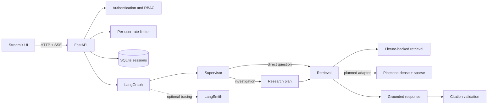

# Enterprise Knowledge Assistant

An explainable, multi-agent enterprise assistant foundation, delivered as one Python modular monolith. This phase provides deterministic mock conversations, API and Streamlit processes, session persistence, role-aware retrieval, and an executable LangGraph workflow.

## Architecture



FastAPI and Streamlit run as separate processes because they have different runtime needs. They share one repository, package, lockfile, and Compose build. Internal capabilities remain in one deployable Python package.

## Requirements and quick start

- Python 3.13 (3.12+ is supported), `uv`, and GNU Make.
- Docker and Docker Compose are optional for containerized startup.

```bash
uv sync
make setup   # creates ignored .env and user file; prints demo credentials
make dev     # starts FastAPI on :8000 and Streamlit on :8501
```

Use the displayed `viewer`, `analyst`, or `admin` credentials in the UI. `make dev` keeps both processes in the foreground; Ctrl+C stops them. Alternatively, run `make api` and `make ui` in separate terminals after setup.

Open [http://localhost:8501](http://localhost:8501). The UI logs in through the API, creates an owned session, and consumes the API's SSE stream. The mock graph returns synthetic, cited evidence without paid provider keys.

## VS Code Python tooling

The workspace formats Python files on save with Autopep8 at an 80-character
line limit. Ruff enforces the same limit in editor diagnostics and CI; Pylint
is disabled for this workspace to avoid duplicate linter output. Install the
recommended VS Code extensions from `.vscode/extensions.json`.

## Docker

Run `make setup` once to create the local ignored `.env`, then:

```bash
docker compose up --build
```

The API and UI containers use the same image and environment file. SQLite data is persisted in the local `data/` directory. `docker compose down` stops the services; it does not remove that local database.

## Development commands

```bash
uv sync --all-groups
make test
make lint
make format-check
make typecheck
make docs-check
make audit
make verify-langsmith
make check
```

`uv.lock` pins the resolved dependency graph. Autopep8 formats Python files; Ruff handles linting and import fixes. GitHub Actions checks Python 3.12 through 3.14, audits installed dependencies weekly and on each change, and builds and starts both Docker services. No CI job requires external credentials.

## Configuration

Copy `.env.example` to `.env`, or let `make setup` generate local-only
credentials. `.env` is ignored by Git. The mock system works without
model-provider keys. LangSmith uses the existing agent ID and environment
from `.env.example`; keep the API key in `.env`. Agent addressing does not
use a tracing project name, and a workspace ID is omitted unless the API
key's scope requires one. Pinecone settings are reserved for the future
production adapter.

Run `make verify-langsmith` to execute a nested, fictional trace and check
for SDK submission errors. The equivalent direct command is
`uv run --env-file .env python scripts/verify_langsmith.py`. The command
reports `VERIFIED` when remote readback confirms the exact agent, environment,
and span tree; it reports `SUBMITTED` when sending succeeds but read access is
unavailable. It never prints the API key or trace payloads.

Important settings include `MOCK_MODE`, `API_BASE_URL`, `SQLITE_PATH`, CORS origins, rate-limit capacity/refill, LangSmith tracing, and Pinecone index/namespace configuration. Never commit `.env` or real provider credentials.

## What is implemented

- Async FastAPI app factory, lifespan, request IDs, JSON logs, CORS, health/readiness, typed routes, and SSE contracts.
- Development authentication with server-side role assignment, backend tool permission checks, and in-memory per-user token buckets.
- SQLite session ownership and turn history.
- A compiled LangGraph graph that streams actual node updates from Supervisor, optional Research planning, Retrieval, Response, and citation validation nodes.
- Deterministic fixture retrieval with access filtering before evidence enters graph state. Citations resolve to actual synthetic chunks.
- Streamlit login/session controls, chat history, response streaming, and graph activity display.
- Agent-addressed LangSmith tracing for chat, LangGraph nodes, tool calls,
  and assistant persistence, with input/output hiding and safe metadata.
- A standalone LangSmith connectivity command that reports submission and
  remote verification as separate outcomes.

## Boundaries and limitations

Pinecone indexing, embedding, sparse ranking, and live hybrid retrieval are interfaces/plans only. The mock adapter uses deterministic lexical matching. The documented production merge strategy is reciprocal-rank fusion so dense and sparse scores are not treated as directly comparable.

Research currently produces a restricted structured plan and permits one bounded retrieval pass. It does not execute generated code or recurse. There is no live LLM, MCP server, production identity provider, distributed rate limiter, semantic memory, or human approval flow. The token registry and event schema are extension points, not evidence that those integrations are complete. In-memory rate limits and login tokens do not coordinate across API processes.

LangSmith tracing remains optional for normal requests. The UI continues to
show application activity events; LangSmith spans are a separate diagnostic
view. The Streamlit UI makes a synchronous HTTP call while consuming the
streamed response, which is suitable for local demonstration.

## Assessment status

See [the evaluation matrix](docs/evaluation-matrix.md) for requirement weights, implementation status, evidence locations, and remaining work. Architecture and assumptions are documented in `docs/`; concise decisions are in `docs/decisions/`.

## Engineering documentation

- [System architecture](docs/architecture.md) and
  [request lifecycle](docs/request-lifecycle.md) explain component and API
  boundaries.
- [Agent design](docs/agent-design.md) and
  [retrieval design](docs/retrieval-design.md) describe graph execution,
  RLM limits, ranking, and evidence.
- [Security](docs/security.md) and
  [observability](docs/observability.md) describe trust boundaries, logs,
  activity events, and LangSmith limitations.
- [Documentation standards](docs/documentation-standards.md) explains the
  Ruff and AST checks. [ADRs](docs/decisions/README.md) record current
  architectural choices and proposed integration boundaries.

## Next milestone

Implement a real Pinecone ingestion and hybrid retrieval slice with role-filtered metadata, citation checks, and LangSmith traces. This validates the highest-risk retrieval and observability assumptions before adding model-driven recursive research.
