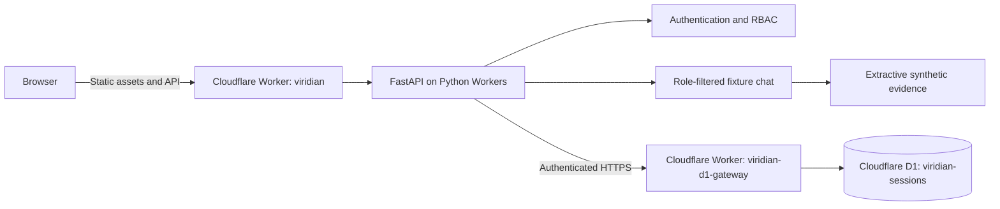

# Viridian

Viridian is an explainable enterprise knowledge assistant. Its canonical
demo runs on Cloudflare Workers: a Python FastAPI API, static web
frontend, authenticated D1 gateway, and D1 session database. The hosted demo
uses only deterministic mock providers and synthetic data; it does not call
OpenAI, Pinecone, or LangSmith.

## Live demo

Open [Viridian](https://viridian.thavarshan.workers.dev/). The public demo
accounts are synthetic. Do not reuse their passwords.

| Account | Password |
|---|---|
| Viewer (`viewer`) | `viewer-demo-2026` |
| Analyst (`analyst`) | `analyst-demo-2026` |
| Administrator (`admin`) | `admin-demo-2026` |

The pre-existing Streamlit Cloud deployment remains active outside this
release pipeline, by request. Cloudflare is the canonical Viridian demo.

## Architecture



The Cloudflare production profile is configured for the Free plan: Workers,
Workers Static Assets, and D1 only. No paid Cloudflare feature or external
paid provider is enabled. The static frontend and API share one origin. The
D1 gateway is the only component with a D1 binding; the API reaches it with a
server-side service token.

## Local development

Requirements: Python 3.12–3.14, `uv`, and GNU Make. Docker Compose is
optional.

```bash
uv sync --all-groups --all-extras
make setup
make dev
```

`make setup` creates local demo users if no user file exists. It prints
generated passwords once and stores them in ignored
`data/users/default.json`. The local Streamlit client uses the local FastAPI
service. Run `docker compose up --build` to use containers instead.

Local OpenAI, Pinecone, and LangSmith integrations are optional. They are
disabled by default and are not used by the Cloudflare demo. For local
Cloudflare-style D1 development, use `make cloud-sim`; the simulation uses a
disposable local D1 database.

## Verification

```bash
make check
make audit
```

`make verify-live` and `make verify-langsmith` explicitly contact optional
external providers and are not required for the Cloudflare deployment.
Review their configuration and account usage before running them.

GitHub Actions runs lint, formatting, package build, tests, type checks,
dependency audits, D1 Worker checks, and deployment configuration checks.
After the full CI gate passes on `main`, it deploys both Viridian Workers,
applies forward-only migrations to `viridian-sessions`, and smoke-checks the
frontend, API, chat stream, authentication, ownership boundaries, and D1
persistence. See [CI/CD operations](docs/ci-cd.md) and the
[Cloudflare deployment guide](docs/deployment.md).

## Implemented behavior

- Server-assigned Viewer, Analyst, and Administrator roles protect tools and
  document access.
- Local Python runs use LangGraph to route greetings, knowledge questions,
  bounded investigations, and supported numeric calculations.
- The Cloudflare demo uses role-filtered fixture search and extractive
  answers. OpenAI and Pinecone adapters remain optional for local work.
- Server-sent events report workflow and tool activity without exposing
  private chain-of-thought.
- D1 stores owner-scoped conversation history. The API holds the D1 gateway
  credential; browser requests never receive it.
- Optional LangSmith tracing redacts inputs and outputs. It is disabled in
  the Cloudflare production configuration.

## Limits

The checked-in corpus is synthetic. Ingestion accepts pre-chunked JSON rather
than arbitrary PDF or DOCX documents. The labeled retrieval evaluation has
four cases. Prompt-injection checks are defense in depth. Production identity,
distributed rate limits, semantic memory, and a human approval flow are not
implemented.

## Guides

- [Architecture](docs/architecture.md) and
  [request lifecycle](docs/request-lifecycle.md)
- [Agent design](docs/agent-design.md),
  [retrieval design](docs/retrieval-design.md), and
  [model provider](docs/model-provider.md)
- [Security](docs/security.md),
  [observability](docs/observability.md), and
  [evaluation matrix](docs/evaluation-matrix.md)
- [Cloudflare deployment](docs/deployment.md)
- [CI/CD and release operations](docs/ci-cd.md)
- [Demonstration guide](docs/demo-guide.md) and
  [architecture decisions](docs/decisions/README.md)

The authoritative assessment is `docs/assignment.md`. Planning files are
kept local and ignored by Git.
