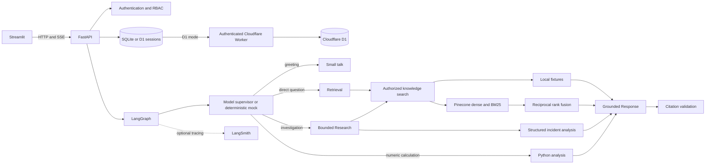

# Viridian

Viridian is an explainable AI assistant built as a modular Python monolith.
FastAPI, Streamlit, LangGraph, SQLite, D1, Pinecone, OpenAI, and LangSmith are
kept behind small internal module boundaries. Deterministic mock mode remains
available for tests and local development.

## Live demo

Open the [Viridian demo](https://viridian.streamlit.app/). In the sidebar, select a user, enter the
matching password, and press **Sign in**.

- Viewer (`viewer`): `viewer-demo-2026`
- Analyst (`analyst`): `analyst-demo-2026`
- Administrator (`admin`): `admin-demo-2026`

These public demo accounts use synthetic data. Do not reuse their passwords.

## Architecture



## Quick start

Requirements: Python 3.12–3.14, `uv`, and GNU Make. Docker Compose is
optional.

```bash
uv sync --all-groups --extra ui
make setup
make dev
```

`make setup` creates local demo users only when no user file exists. It prints
generated passwords once; they are stored in the ignored
`data/users/default.json`. Open <http://localhost:8501> and sign in. The UI
uses FastAPI for authentication, sessions, chat, and event streaming.

For deterministic mock mode, use `MOCK_MODE=true` and
`LLM_PROVIDER=mock`. For live model answers and Pinecone retrieval, configure
local `.env` credentials, set `MOCK_MODE=false` and `LLM_PROVIDER=openai`,
then start the services again. The application does not silently fall back
to mock output when a live provider fails.

Docker Compose startup:

```bash
docker compose up --build
```

The API and UI use the same image. SQLite and local data are mounted under
`data/`.

For a local cloud-style simulation with a Wrangler Worker and disposable D1
state, use `make cloud-sim`. Stop it with `make cloud-sim-down`; its named
local database volume remains available. See the
[multi-cloud deployment guide](docs/deployment.md) for setup and test details.

## Verification

```bash
make check
make audit
make verify-langsmith
make verify-live
make evaluate-retrieval
```

`make verify-live` is opt-in and requires working OpenAI, Pinecone, and
LangSmith credentials. It writes the checked-in synthetic incident corpus
to the configured existing Pinecone namespace, sends a small set of model
requests, and requires remote LangSmith read access. It does not create an
index or delete records. `make evaluate-retrieval` runs a separate four-case
synthetic evaluation. Neither result predicts quality on production data.

CI runs separate quality, build, test, type, Python and npm dependency,
Worker/D1, GitHub Actions syntax, deployment configuration, and
Docker Compose API checks. Python tests cover 3.12 through 3.14. The required
`ci-gate` fails if any check fails, is cancelled, or is skipped. Production
Cloudflare and Vercel deployment runs automatically after the full CI gate
passes on `main`, followed by API and Worker smoke checks. Streamlit
Community Cloud follows `main` and rebuilds on a push; CI does not probe its
frontend. See [CI/CD operations](docs/ci-cd.md).

## Implemented behavior

- Server-assigned Viewer, Analyst, and Administrator roles protect tools and
  document access. User and model input cannot grant permissions.
- LangGraph routes greetings, direct knowledge questions, multi-step
  investigations, and supported numeric calculations.
- OpenAI structured output handles live routing, research decomposition,
  and cited response claims. Deterministic mock behavior is separately
  tested.
- Bounded Research performs multiple authorized searches, retains full
  source identity, and can aggregate explicit incident metadata with trusted
  Python.
- Pinecone dense and BM25 full-text searches use trusted metadata filters
  and reciprocal rank fusion. A synthetic 18-incident corpus demonstrates
  retrieval, date filtering, and source-backed cause counts.
- SQLite stores owner-scoped conversation history; recent turns are passed
  to the model as bounded context.
- SSE events report graph and tool activity. Answer chunks are emitted only
  after source identity validation.
- LangSmith tracing redacts run inputs and outputs and filters metadata.
  Live tests read back model-backed workflow traces and check their hierarchy.

## Limits

The checked-in data is synthetic. Ingestion accepts pre-chunked JSON rather
than arbitrary PDF or DOCX documents. The labeled retrieval evaluation has
four cases. The input guardrail detects selected obvious patterns, not every
prompt injection. MCP, semantic memory, production identity, distributed
rate limits, and a human approval flow are not implemented. SQLite, users,
and rate limits are local demonstration components. No recording is included.

## Guides

- [Architecture](docs/architecture.md) and
  [request lifecycle](docs/request-lifecycle.md)
- [Agent design](docs/agent-design.md),
  [retrieval design](docs/retrieval-design.md), and
  [model provider](docs/model-provider.md)
- [Security](docs/security.md),
  [observability](docs/observability.md), and
  [evaluation matrix](docs/evaluation-matrix.md)
- [Multi-cloud deployment guide](docs/deployment.md)
- [CI/CD and release operations](docs/ci-cd.md)
- [Demonstration guide](docs/demo-guide.md) and
  [architecture decisions](docs/decisions/README.md)

The authoritative assessment is `docs/assignment.md`. Planning files are
kept local and ignored by Git.

[live-demo]: https://enterprise-knowledge-assistant-g6qo3szfwp33c9yqdp2t2o.streamlit.app/
