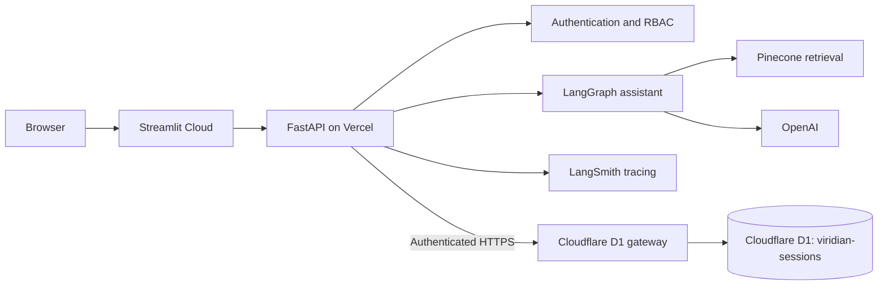

# Viridian

Viridian is an explainable enterprise knowledge assistant. The hosted
platform uses Streamlit Cloud for the UI, Vercel for the FastAPI backend,
and Cloudflare D1 for session storage through an authenticated gateway.

## Live demo

Open the active Streamlit Cloud app for the UI. The FastAPI health endpoint
is [viridian-api.vercel.app/health](https://viridian-api.vercel.app/health).
The public demo accounts use synthetic data; do not reuse their passwords.

| Account | Password |
|---|---|
| Viewer (`viewer`) | `viewer-demo-2026` |
| Analyst (`analyst`) | `analyst-demo-2026` |
| Administrator (`admin`) | `admin-demo-2026` |

Streamlit Cloud deploys UI changes from its configured Git branch. GitHub
Actions gates the D1 gateway and Vercel API deployments on `ci-gate`.

## Architecture



The FastAPI backend runs on Vercel with the configured OpenAI, Pinecone,
LangGraph, and LangSmith integrations. Cloudflare hosts the narrow D1 gateway
and database; the API reaches them with a server-side service token.

## Local development

Requirements: Python 3.12–3.14, `uv`, and GNU Make. Docker Compose is
optional.

```bash
uv sync --all-groups --all-extras
make setup
make dev
```

`make setup` creates local demo users if no user file exists. It prints
generated passwords once and stores them in ignored
`data/users/default.json`. The local Streamlit client uses the local FastAPI
service. Run `docker compose up --build` to use containers instead.

Local OpenAI, Pinecone, and LangSmith integrations are optional. They are
disabled by default; configure them through `.env` for local provider use.
For local Cloudflare-style D1 development, use `make cloud-sim`; the
simulation uses a disposable local D1 database.

## Verification

```bash
make check
make audit
```

`make verify-live` and `make verify-langsmith` explicitly contact optional
external providers and are not required for the hosted release.
Review their configuration and account usage before running them.

GitHub Actions runs lint, formatting, package build, tests, type checks,
dependency audits, D1 Worker checks, and deployment configuration checks.
After the full CI gate passes on `main`, it applies forward-only migrations
to `viridian-sessions`, deploys the D1 gateway, then deploys the FastAPI
backend to Vercel. It smoke-checks the gateway and API health, readiness, and
provider configuration. See [CI/CD operations](docs/ci-cd.md) and the
[deployment guide](docs/deployment.md).

## Implemented behavior

- Server-assigned Viewer, Analyst, and Administrator roles protect tools and
  document access.
- Local Python runs use LangGraph to route greetings, knowledge questions,
  bounded investigations, and supported numeric calculations.
- The hosted API uses LangGraph to route knowledge questions, bounded
  investigations, and supported numeric calculations.
- Server-sent events report workflow and tool activity without exposing
  private chain-of-thought.
- D1 stores owner-scoped conversation history. The API holds the D1 gateway
  credential; browser requests never receive it.
- LangSmith tracing redacts inputs and outputs before sending traces.

## Limits

The checked-in corpus is synthetic. Ingestion accepts pre-chunked JSON rather
than arbitrary PDF or DOCX documents. The labeled retrieval evaluation has
four cases. Prompt-injection checks are defense in depth. Production identity,
distributed rate limits, semantic memory, and a human approval flow are not
implemented.

## Guides

- [Architecture](docs/architecture.md) and
  [request lifecycle](docs/request-lifecycle.md)
- [Agent design](docs/agent-design.md),
  [retrieval design](docs/retrieval-design.md), and
  [model provider](docs/model-provider.md)
- [Security](docs/security.md),
  [observability](docs/observability.md), and
  [evaluation matrix](docs/evaluation-matrix.md)
- [Production deployment](docs/deployment.md)
- [CI/CD and release operations](docs/ci-cd.md)
- [Demonstration guide](docs/demo-guide.md) and
  [architecture decisions](docs/decisions/README.md)

The authoritative assessment is `docs/assignment.md`. Planning files are
kept local and ignored by Git.
