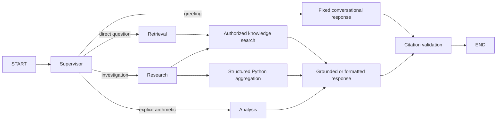

# Agent and graph design

## Workflow overview

The compiled LangGraph graph uses a configured ModelProvider. OpenAI mode
returns validated structured routing and answer claims. Mock mode keeps
routing and answers deterministic for offline tests. The model selects a
workflow only; backend identity, permissions, and retrieval access remain
outside the model boundary.

The graph has no autonomous tool-selection loop. Research uses a bounded
executor outside the graph topology. It recursively expands structured
subtasks, makes authorized searches, and fuses evidence by complete
document/chunk identity.

Plain greetings, thanks, farewells, and brief capability questions use a
fixed small-talk reply. They do not invoke retrieval. Longer factual requests
go through Retrieval, Research, or numeric Analysis.

## Node contracts

| Node | Responsibility |
|---|---|
| Supervisor | Selects small talk, retrieval, research, or numeric analysis. |
| Retrieval | Calls knowledge search through the role policy registry. |
| Research | Decomposes, searches, and aggregates bounded evidence. |
| Analysis | Runs validated literal-number arithmetic for analyst/admin. |
| Response | Renders conversational replies, analysis, or cited claims. |
| Validate | Checks full source identity pairs before emitting answer chunks. |

Knowledge search is available to all roles. Python arithmetic and incident
analysis are allowed to analysts and administrators. The MCP policy exists,
but there is no MCP server or executable handler.

## Model routing and research

The live OpenAI Supervisor selects Retrieval for a direct question about one
fact or source, Research for comparison and synthesis, and Analysis only for
supported arithmetic over numeric literals. A deterministic provider keeps
the same interfaces usable without credentials.

Research receives a validated TaskDecomposition containing one to four
distinct query strings. SearchPlan is the declarative Python plan contract.
Its interpreter applies server-set depth and call limits; model output cannot
raise those limits or request executable code.

Each leaf uses KnowledgeSearchTool and ToolRegistry. The tool derives access
levels from the authenticated graph state. Question filters may narrow by a
known department, supported document type, and inclusive date range. They
cannot broaden the role-derived access set.

The executor enforces this shared budget:

| Limit | Value |
|---|---:|
| Maximum recursion depth | 2 |
| Knowledge search calls | 4 |
| Retrieved chunks | 20 |
| Total investigation time | 30 seconds |
| Incident-analysis batch size | 5 records |

Leaf findings keep their task and source identities. Results use reciprocal
rank fusion by complete document/chunk identity. Duplicate expansion is
prevented, partial failures preserve successful siblings, and cancellation
propagates.

## Structured incident analysis

Aggregate incident questions such as “Summarize payment outages during the
last year and identify recurring root causes” route to Research. The graph
retrieves only authorized incident reports, filters them with the same
inclusive rolling-year window, and copies explicit metadata into validated
IncidentEvidence records.

IncidentAnalysisTool uses trusted Python to count distinct incidents,
group source-classified root causes, calculate percentages, and retain every
supporting source identity. Repeated chunks count once per incident.
Conflicting cause labels and missing labels remain unknown. The tool does
not infer causes from prose or execute model-generated Python.

Analyst and Administrator roles may run this analysis. Viewer requests are
rejected before the tool executes. The graph reports bounded counts and
source IDs in activity events; the final summary is deterministic and
citation-validated against evidence returned in this turn.

The separate Analysis node remains a narrow calculator for count, sum, and
average of comma-separated finite numbers. Its role check runs before the
tool handler.

## State, history, and streaming

ChatService loads up to twelve recent owner-scoped messages into graph
context and omits the current message, which is already the question. The
graph has no checkpointer; a LangGraph thread ID is correlation metadata,
not durable state.

The UI receives agent and tool starts/completions, route decisions, retrieval
source IDs, research counts, validation outcomes, memory updates, and safe
failure codes. Response chunks are emitted only after citation validation.
Activity data contains no chain-of-thought, prompts, or document content.

## Verification and limits

Deterministic unit tests cover recursive budgets, partial failures,
deduplication, source attribution, date filtering, arithmetic, and tool
authorization. The opt-in live suite verifies OpenAI routing, a multi-subtask
comparison over Pinecone, date-bounded incident analysis, arithmetic, Viewer
denial, and remote LangSmith trees.

The live suite passed on 2026-11-15. It uses a small synthetic corpus and
does not establish production relevance or adversarial robustness.
