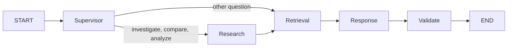

# Agent and graph design

## What "agent" means in this implementation

The graph contains named workflow nodes, but no language model currently
makes decisions or writes answers. Routing uses fixed keyword checks,
retrieval calls one injected tool, and response construction copies
retrieved fixture text with citations. The labels Supervisor, Research,
Retrieval, Response, and Validate describe responsibilities in a bounded
workflow; they do not imply autonomous model reasoning.

There are no graph cycles, retry edges, human-approval interrupts, or
tool-selection loops. Each run visits one of two paths and terminates after
validation.

## Node contracts

| Node | Reads | Writes | Behavior and failure boundary |
|---|---|---|---|
| Supervisor | `question`, request/session IDs | `route`, event | Case-folds the question and checks for three fixed substrings. |
| Research | `question`, request/session IDs | `search_plan`, event | Wraps the original question as one validated query under a fixed budget. |
| Retrieval | `question`, optional `search_plan`, trusted `role` | serialized results, source events | Calls `ToolRegistry`, then `KnowledgeSearchTool`; failures stop downstream nodes. |
| Response | serialized results | deterministic response, citations, event | Uses at most two retrieved chunks or returns a fixed no-evidence message. |
| Validate | response, citations, retrieved chunks | final response, validation flag, events | Checks citation markers; only then emits response chunks. |

The retrieval node is the only current executable tool handoff. ToolRegistry
contains policies for knowledge search, analytics, and MCP, but its handler
map in the graph contains only knowledge search. The analytics request model,
MCP protocol, and input/output guardrail protocols are contracts, not active
tools or defenses.

## Routing and execution decisions

The Supervisor uses case-insensitive substring matching for
`investigate`, `compare`, and `analyze`. A match selects the Research path;
all other text selects direct retrieval. Matching is not semantic intent
classification, and a word occurring inside a larger token also matches.

Research builds a `SearchPlan` containing the question, then calls
`interpret_search_plan` with `max_depth=1`, `max_search_calls=1`,
`max_documents=5`, and `timeout_seconds=15`. The current interpreter checks
the depth and limits the query tuple to the allowed call count. The graph
uses the query as search wording; it cannot grant access or choose a tool.
The five-document budget is passed as the result limit.

`timeout_seconds` is validated but not enforced by a timer or cancellation
scope. No recursive task scheduler, document batching, aggregation step,
deduplication cache, or partial-result policy is implemented.
`TaskDecomposition` and `BatchAnalysis` are validated models with no graph
consumer.

The planner accepts structured strings and passes them to an approved search
handler. It does not generate or execute Python, shell commands, or
filesystem operations. There is consequently no Python search-plan sandbox
in this version; no arbitrary code path exists.

## Shared graph state

`AgentState` is a `TypedDict(total=False)`. Nodes return partial dictionaries,
so fields are optional at the type level even when a particular node expects
them at runtime. The API initializes request ID, session ID, user ID, role,
question, and events.

The event field is declared as
`Annotated[list[dict[str, Any]], operator.add]`. LangGraph concatenates event
updates from each node. Other fields use the graph's ordinary update
semantics; a node's value for a key replaces the existing value.

Identity and role are created by `ChatService` from the API's authenticated
user. Do not initialize graph state from client-provided role or owner
fields. Retrieved results and citations are serialized at node boundaries
and validated again before response construction.

The session ID is passed as LangGraph `thread_id` metadata, but
`build_graph` compiles without a checkpointer. Each chat turn gets a fresh
state. Stored conversation messages are not loaded into that state, so the
graph does not have conversational memory.

## Evidence and explainability

The graph exposes observable decisions and evidence rather than hidden
chain-of-thought:

- `agent_transition` states which workflow or response stage ran.
- `tool_execution` identifies the knowledge-search tool and result count.
- `retrieval` includes source document IDs, chunk IDs, titles, and scores.
- `validation` reports whether citation markers passed.
- `response_chunk` carries an 80-character slice after validation.
- `failure` reports a stable error code and generic message.

Activity events are structured execution records, not a complete graph state
dump. They do not contain model reasoning. There is no model in this graph
whose hidden chain-of-thought could be surfaced.

## Citation gate and containment

`grounded_response` copies citation metadata from each selected
`SearchResult` and constructs markers from those IDs. Validation compares
the answer's markers with citations whose chunk IDs appeared in the retrieved
set. The graph builds those citations from retrieved chunks in normal
execution.

The helper does not independently compare full `(document_id, chunk_id)`
pairs against retrieved pairs. A colliding chunk ID paired with a different
document ID could pass the helper if citation state were forged. The
current deterministic path does not accept client-supplied citation state,
but a model-backed path should validate full pairs and identifier syntax.

When retrieval or response construction raises, ChatService logs the
exception type with the request ID, emits a generic failure, and does not
persist an assistant response. The route has a second generic failure
boundary for exceptions that escape while streaming. The already-stored
user message remains. There are no retries, so a failure cannot multiply
side effects through a retry loop; it also means transient failures require
a new user request.

## Recursive Language Model extension boundary

The current Research node is a bounded planning scaffold, not an RLM
implementation. `SearchPlan` and `ExecutionBudget` validate fields; only the
single-query flow is used. Recursion, batch exploration, result aggregation,
shared wall-clock cancellation, and retry classification remain planned.

An RLM implementation should keep source documents outside model context,
select bounded batches or summaries, and aggregate only validated results.
It should enforce shared depth, call, document, and elapsed-time budgets
across child tasks, deduplicate repeated work, and define whether partial
results are usable. Do not execute generated Python to implement a search
plan. See `docs/roadmap.md` for the planned work.
