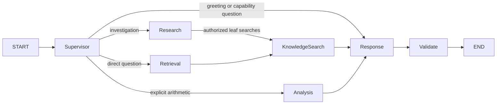

# Agent and graph design

## Workflow overview

The application compiles a LangGraph workflow around a configurable
`ModelProvider`. OpenAI structured output is used when selected; the
deterministic mock provider keeps local development and tests independent
of credentials. Provider output can select a route and propose query text,
but cannot select a role, access level, department filter, or tool policy.

The graph has no cycles or autonomous tool-selection loop. Research uses a
bounded recursive executor outside the LangGraph topology. It can execute
multiple authorized searches, then returns one aggregated evidence set to
the Response node.

Plain greetings, thanks, farewells, and brief capability questions use a
small-talk route directly to Response. The route returns a fixed
product-aware reply and does not search documents or call the answer model.
Mock mode recognizes a bounded phrase list; the live Supervisor selects the
route through its validated structured output. Longer factual requests
continue through retrieval, research, or analysis.

## Node contracts

| Node | Reads | Writes | Behavior |
|---|---|---|---|
| Supervisor | Question, recent history | Route, event | Provider returns a validated small-talk, retrieval, research, or analysis choice. |
| Research | Question, authenticated role | Results, findings, budget summary, events | Recursively decomposes, searches, and fuses bounded findings. |
| Retrieval | Question, authenticated role | Results and source event | Runs one direct search through the authorized tool registry. |
| Analysis | Question, authenticated role | Validated numeric result or safe failure | Parses explicit numeric literals and calls role-gated Python arithmetic. |
| Response | Question, authorized serialized results | Response and citations | Gives a fixed conversational reply, returns an analysis result, or uses provider claims citing full document/chunk identities. |
| Validate | Response, citations, retrieved identities | Final response, validation flag, events | Withholds model output if source identities do not match. |

`ToolRegistry` has policies for knowledge search, Python analysis, and MCP.
Knowledge search and Python analysis have executable handlers; MCP remains
an interface and policy boundary without an installed handler.

## Routing and recursive research

The real Supervisor uses structured provider output to select `retrieval` or
`research`. The deterministic mock selects research for questions that
contain `investigate`, `compare`, or `analyze`. This simple rule is only the
offline test behavior; it is not presented as real intent classification.

`BoundedResearchExecutor` calls the provider's structured decomposition
method. A task with multiple subtasks recursively expands until it reaches a
single search task or the depth limit. Every leaf calls the same
`KnowledgeSearchTool` and `ToolRegistry` used by direct retrieval. The
backend derives allowed access levels from the authenticated role before
the retriever receives any query.

The graph constructs an `ExecutionBudget` for research:

| Limit | Value | Enforcement |
|---|---:|---|
| Maximum recursion depth | 2 | A task at the limit becomes a search leaf. |
| Retrieval calls | 4 | A shared counter blocks additional calls. |
| Retrieved documents | 20 | Each leaf reserves remaining result capacity. |
| Total elapsed time | 30 seconds | Decomposition and retrieval calls use the remaining deadline. |

Each call returns at most five chunks, bounded by remaining document
capacity. Provider subtasks are validated, trimmed, deduplicated, and
limited to four strings of at most 500 characters. The executor does not
execute model-generated Python, shell commands, or filesystem operations.

Each leaf finding retains its task and source results. The final evidence
list uses reciprocal rank fusion by complete `(document_id, chunk_id)`
identity, so repeated evidence is combined without comparing unrelated
search score scales. The response model receives the resulting authorized
evidence and must cite exact identities. The graph also retains per-task
source IDs in its research state for explainability.

Decomposition or search failures are represented by safe failure codes.
When a branch fails, successful sibling results remain available to the
Response node. If decomposition fails, the executor searches the current
objective as a bounded leaf. Cancellation propagates to the caller and is
not converted into a partial success.

The deterministic incident demonstration splits symptoms, causes, and
mitigations into three searches. The unit and graph tests verify all three
branches execute, viewer filters remain applied, and source attribution is
preserved. Live OpenAI decomposition still requires a successful external
model call; see `docs/roadmap.md`.

An explicit command such as `calculate average of 10, 20, 30` selects the
analysis route. The parser accepts only a count, sum, or average over
comma-separated decimal literals; ToolRegistry denies viewers before the
handler runs. The result is deterministic and does not use retrieved
documents or execute generated code.

## Shared graph state and conversation history

`AgentState` is a `TypedDict(total=False)`. Nodes return partial
dictionaries, so fields are optional at the type level even when a node
expects them at runtime. The API initializes request ID, session ID, user
ID, role, question, recent history, and events.

The event field uses `operator.add`, so LangGraph appends node event lists.
Ordinary fields use the graph's standard update behavior. Identity and role
come from the authenticated API user. Never initialize graph state from
client-supplied role or owner fields.

The session ID is passed as LangGraph `thread_id` metadata, but the graph
has no checkpointer. `ChatService` loads up to twelve recent owner-scoped
messages and supplies them to the model provider; history is not durable
graph state.

## Events and citation validation

The graph streams `agent_start` and `agent_complete` around node execution,
and `tool_start` and `tool_complete` around each actual search or arithmetic
call. Failures carry stable error codes without provider text. Node updates
also emit workflow decisions, retrieval source IDs, validation results, and
response chunks. Chunks are slices of the completed, validated answer, not
provider token streaming. Research lifecycle events expose call counts and
result counts without search queries or document contents.

The Response provider receives only results returned after server-side
filtering. Model citations are resolved against the complete pair of
document ID and chunk ID, then canonical metadata is copied from the
retrieved chunk. The validation node checks markers against the full set of
retrieved pairs. Unknown identities cause the answer to be withheld.

See `docs/security.md` for prompt-injection, tool-input, and data-exfiltration
controls as they are implemented in Phase 4.
