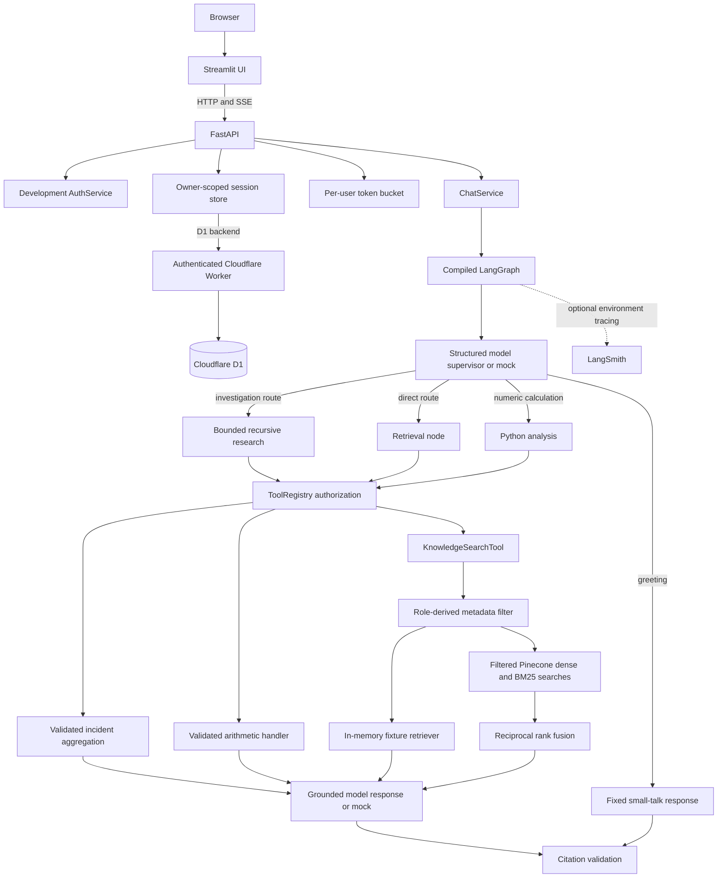
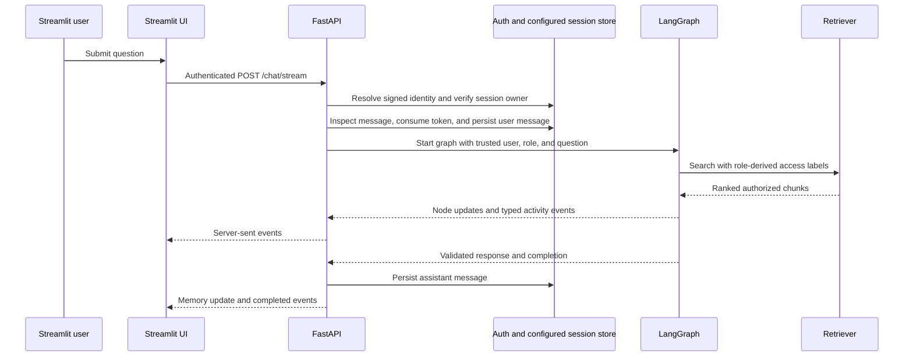

# System architecture

## Overview

The repository is a modular Python monolith with separate FastAPI and
Streamlit processes. They share backend contracts and a Python lockfile; the
UI has a small standalone dependency file. Domain, API, retrieval, memory,
security, tools, agents, and observability remain in the monolith. The
Cloudflare Worker is a narrow persistence adapter, not another business API.

Mock mode remains deterministic. With `LLM_PROVIDER=openai`, the structured
OpenAI adapter routes messages, decomposes research, and generates grounded
claims. On 2026-11-15, a live test verified Retrieval, multi-subtask
Research, document-backed incident analysis, numeric Analysis, and a
Viewer-denied request. Pinecone dense and BM25 queries, trusted metadata
filters, and RRF were verified against the configured schema and synthetic
corpus. LangSmith readback verified seven model-backed and failure trace
trees. This evidence covers synthetic assessment data only.

## Component and execution map

## Responsibilities and contracts

| Layer | Responsibility |
|---|---|
| Streamlit | Login, sessions, chat, history, and activity. |
| FastAPI | Contracts, identity, ownership, limits, and SSE. |
| ChatService | Builds state, consumes updates, and persists answers. |
| LangGraph | Routes, researches, retrieves, analyzes, responds, validates. |
| Security | Resolves users and enforces input and tool policies. |
| Retrieval | Applies filters, searches, and fuses ranked results. |
| Memory | Stores owner-scoped sessions in local SQLite or Cloudflare D1. |
| Observability | Logs, activity events, and optional external traces. |

Streamlit calls FastAPI for all user and conversation data. An async storage
contract selects either an async wrapper around SQLite or an HTTP D1 adapter.
The D1 Worker is a storage gateway, not a second business-logic backend.
Seven live trace trees were read back on 2026-11-15; see
`docs/observability.md` for their IDs and verification details.

The API service container is created by the application factory. Tests can
inject a session store or retriever; ordinary startup selects SQLite and
uses mock fixture retrieval unless mock mode is disabled. Setting
`LLM_PROVIDER=openai` independently enables the OpenAI model adapter; it
requires a key and does not change authorization policy. Disabling mock
retrieval loads `HybridRetriever` with two filtered Pinecone query modes and
RRF. The API does not create the configured index or namespace.

## Request and data boundaries

The API creates graph identity fields from the bearer token. A submitted role,
owner ID, or access-level list is not an authorization source. The retrieval
tool maps the authenticated role to access labels before calling the adapter.
The fixture adapter applies access and optional department filtering before
scoring content. Pinecone applies the same trusted filters in its provider
query and rechecks returned metadata before converting content into graph
state.

The UI loads persisted message history for rendering. ChatService also reads
the latest owner-scoped messages and passes prior turns into graph state for
model context. It omits the current user message, already supplied as the
question. Provider prompts receive only the twelve most recent prior
messages, with content truncated to 4,000 characters per message.

## Graph behavior and failure containment

The configured model returns a validated small-talk, retrieval, research,
or numeric-analysis route. Research asks the provider for validated subtask
strings, recursively expands tasks up to depth two, and runs at most four
authorized searches under twenty-document and thirty-second budgets. It
preserves successful sibling results after a partial search failure and
fuses evidence by complete document/chunk pairs.

Incident aggregate questions use Research, which analyzes authorized source
metadata in batches with trusted Python. It counts distinct incidents,
groups explicitly classified root causes, and retains source attribution.
Numeric commands use a separate arithmetic tool with a narrow literal
grammar and Analyst/Administrator authorization. No model-generated code
is executed. The input guard blocks selected override and
credential-exfiltration patterns before persistence. See
`docs/model-provider.md`, `docs/security.md`, and `docs/agent-design.md`.

Graph node updates use a reducer that appends each node's event list.
LangGraph custom streaming emits agent and tool start/completion events while
those operations run; failures emit safe codes. Activity metadata contains
counts and source identities, not model reasoning or search text. The graph
has no cycles, retries, or open-ended model-driven tool loop. It compiles
without a checkpointer; a session ID passed as LangGraph thread metadata does
not make state durable.

The user message is stored before graph execution. A graph failure becomes a
generic activity event and prevents assistant-answer persistence. The route
also catches exceptions escaping the service after SSE begins and returns a
generic stream-failure event. Provider exception messages are not sent to the
client. A live provider error fails the turn; it does not silently return a
deterministic answer. An assistant persistence failure may leave a user
message without a matching assistant message.

## Retrieval and evidence limits

The local retriever tokenizes query terms and document title/content, applies
role and department filters first, and ranks by lexical overlap. It remains a
deterministic mock score. In Pinecone mode, the configured document schema
provides an embedding query and BM25 full-text query. Both rankings are
filtered and merged by reciprocal rank fusion. `scripts/ingest_pinecone.py`
upserts eighteen synthetic incident chunks under stable document/chunk IDs.
Live checks cover semantic paraphrase, exact incident-ID lookup, Viewer
filtering, and a four-case labeled evaluation. See
`docs/retrieval-design.md` for schema, metrics, and limits.

## Process, configuration, and operations

| Process | Default port | Runtime |
|---|---:|---|
| FastAPI | 8000 | Uvicorn; reads API and provider settings. |
| Streamlit | 8501 | UI process; calls FastAPI over HTTP. |
| D1 Worker | 8787 local | Wrangler local mode or Cloudflare Workers. |

Docker Compose builds the same image for the API and UI. The UI waits for the
API readiness check; the API mounts local `data/` for SQLite and fixture
files. The readiness endpoint checks the session store only. It does not
test Pinecone or LangSmith. `MEMORY_BACKEND=sqlite` is the default. Cloud
deployment selects `MEMORY_BACKEND=d1`, and FastAPI calls the dedicated
Worker over HTTPS with a service token. Only the Worker holds a D1 binding.

`make setup` prepares local credentials and `make dev` starts both local
processes. `make check` runs local lint, comment, line-length, formatting,
package build, type, docstring, syntax, and test checks. `make verify-live`
runs the opt-in OpenAI, Pinecone, and LangSmith end-to-end test;
`make evaluate-retrieval` runs the labeled Pinecone evaluation.

The single `.github/workflows/ci.yml` workflow has separate jobs for lint,
format, docblocks, comments, line length,
syntax, package build, tests, type checking, Python/npm dependency audits,
Worker/D1,
Streamlit startup, GitHub Actions syntax, deployment configuration, and
Docker Compose smoke. Pytest has a Python 3.12, 3.13, and 3.14 matrix. The
Worker job validates Wrangler config, applies local D1 migrations, checks
types and routes, and tests the Python API adapter through Wrangler. The
Compose job starts the existing services with `docker compose up`, checks
API health and readiness, opens the UI, and verifies UI-to-API connectivity.
An explicit `ci-gate` fails for any required job that fails, is cancelled, or
is skipped.

The same workflow contains the optional deployment chain: Cloudflare
deployment and smoke, Vercel staging and smoke, Vercel promotion, Streamlit
branch promotion and readiness, then separate post-deployment smoke jobs. A
non-cancelling concurrency group serializes runs, and every mutation checks
that the approved SHA still matches `main`. Production deployment and the
one live model-backed end-to-end smoke require separate explicit opt-ins.
They remain skipped until enabled in the protected GitHub environment. See
[CI/CD operations](ci-cd.md).

Environment variable names and defaults are described in
`docs/assumptions.md` and `.env.example`. Secret values
are excluded from Pydantic Settings representations. Local credentials,
database files, and assessment planning files remain ignored by Git.

## Infrastructure, development, and tests

The Dockerfile copies the uv executable into a Python 3.13 slim image,
installs the locked runtime dependencies, then copies source, apps, and data
before installing the project. It excludes development dependencies from
the runtime image and starts Uvicorn on port 8000 by default.

Compose builds that image for both services. The API mounts the host data
directory at /app/data so SQLite and local fixture/account files are
available. Its readiness check calls /ready, which verifies the session
store. The UI uses Compose service DNS at http://api:8000 and waits until the
API is healthy. Host ports default to 8000 and 8501 and can be overridden by
the process environment.

The local launcher first checks the development-user setting and invokes the
bootstrap script if its account file is missing. Bootstrap creates a JSON
file with restrictive permissions and updates .env without replacing
existing inline credentials or an existing file. The launcher starts
Uvicorn and Streamlit as child processes and terminates both when either
exits or the operator interrupts the command.

| Make target | Purpose |
|---|---|
| `setup` | Sync dependencies and create local development credentials. |
| `dev` | Bootstrap if needed and start both local processes. |
| `api` / `ui` | Start one development process in a separate terminal. |
| `test` | Run unit and offline integration tests. |
| `lint` | Run Ruff lint rules. |
| `comments-check` | Reject commented-out Python with Ruff ERA001. |
| `line-length-check` | Enforce the configured 80-character Python limit. |
| `format` / `format-check` | Apply or verify Autopep8 formatting. |
| `build` | Build the source distribution and wheel. |
| `typecheck` | Run strict mypy over `src` and `apps`. |
| `docs-check` | Run the AST docstring validator. |
| `syntax-check` | Compile Python files without executing them. |
| `audit` | Check installed dependencies with pip-audit. |
| `check` | Run local checks except dependency audit and Docker. |
| `verify-langsmith` | Send a synthetic trace and verify readback/redaction. |
| `verify-live` | Run opt-in OpenAI, Pinecone, and LangSmith workflows. |
| `evaluate-retrieval` | Measure dense, BM25, and RRF on labeled cases. |
| `docker-up` / `docker-down` | Start or stop default Compose services. |
| `cloud-sim` / `cloud-sim-down` | Run or stop local Worker, D1, API, and UI. |
| `cloud-sim-test` | Run API integration through local Wrangler and D1. |

Runtime and development dependencies are declared in pyproject.toml and
resolved in uv.lock. Python metadata supports 3.12 through 3.14. CI runs
lint, formatting, package build, tests, docblock, comment, line-length,
syntax, type, and dependency-audit checks as separate jobs. The test matrix
runs pytest on all three supported minor versions. A Cloudflare job tests
Worker routes against local D1 and exercises the Python adapter through
Wrangler. A Docker Compose job starts the existing API and UI. GitHub Actions
are pinned to commit SHAs and repository permissions are read-only.

Pytest uses automatic asyncio mode and a function-scoped event loop. The
shared client fixture creates a temporary SQLite database, synthetic local
accounts, fixture retrieval, and disabled tracing. Standard tests exercise
graph, retrieval, security, API routes, SSE, persistence, failures, and UI
imports without external service calls. `make verify-live` is opt-in: it
upserts the synthetic records and exercises OpenAI, Pinecone, and LangSmith.
Cloudflare checks use local emulation and do not require account access.

## Async and scaling constraints

FastAPI endpoints and graph node functions are async, but not every
dependency is non-blocking. The SQLite adapter offloads synchronous calls to
worker threads. D1 uses async httpx with bounded timeouts. Fixture search
performs its in-memory scan in the event loop. Pinecone SDK calls use worker
threads and operation timeouts. The Streamlit API client uses blocking httpx
while the UI consumes SSE. Higher concurrency needs measurement.

Signed tokens verify across API instances that share the same signing key,
issuer, and audience. Tokens cannot be revoked individually before expiry.
Rate-limit buckets remain process-local. SQLite is local; D1 is a separate
cloud adapter. Production use still needs a reviewed identity, quota,
retention, and tracing policy.

## Related guides

- `docs/request-lifecycle.md`: endpoint and SSE sequence.
- `docs/agent-design.md`: nodes, state, routing, and RLM scope.
- `docs/retrieval-design.md`: metadata, scoring, and citations.
- `docs/security.md`: trust boundaries and limitations.
- `docs/deployment.md`: Vercel, Streamlit, and Cloudflare setup.
- `docs/observability.md`: logs, events, and LangSmith behavior.
- `docs/decisions/`: recorded architectural decisions.
