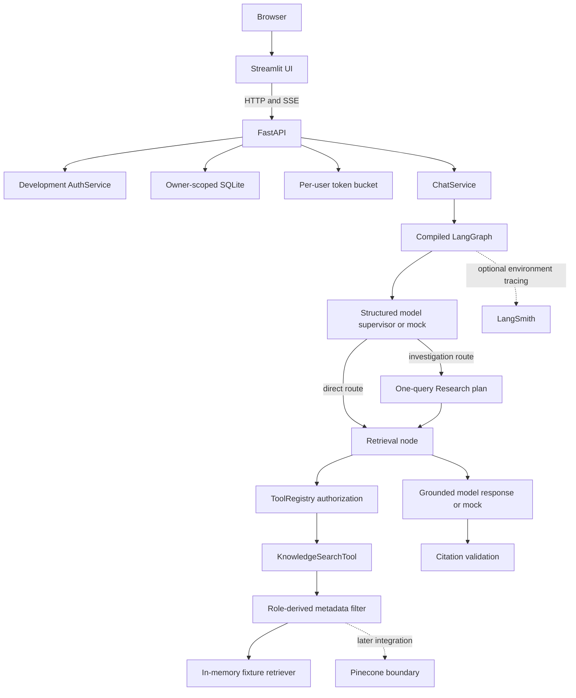
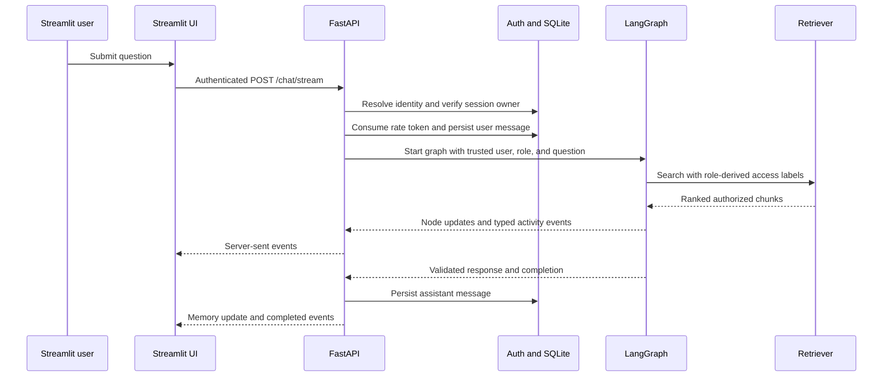

# System architecture

## Overview

The repository is a modular monolith with separate FastAPI and Streamlit
processes. The processes share a Python package and dependency lockfile.
Domain, API, retrieval, memory, security, tools, agents, and observability
remain internal module boundaries rather than separate services.

Mock mode remains deterministic. Setting `LLM_PROVIDER=openai` selects the
structured OpenAI adapter for supervisor routing and grounded answer claims.
The provider is wired but has not been verified with a live model because no
OpenAI API key is configured in this workspace. Pinecone remains a later
retrieval integration phase.

## Component and execution map

## Responsibilities and contracts

| Layer | Responsibility | Current boundary |
|---|---|---|
| Streamlit | Login, session selection, history, chat, activity display | Uses a synchronous httpx client; all backend data comes from FastAPI. |
| FastAPI | HTTP schemas, identity, ownership, rate checks, SSE transport | Async routes call synchronous SQLite methods directly. |
| Chat service | Build per-turn state, consume graph updates, persist final answer | Graph and assistant persistence are separate failure boundaries. |
| LangGraph | Route, search, generate claims, validate citations | Configurable structured model provider; deterministic mock remains default. |
| Security | Resolve local users and enforce tool roles | Local-only tokens and in-memory limits; see the security guide. |
| Retrieval | Filter fixture content and rank lexical overlap | Pinecone, ingestion, embeddings, sparse search, and live fusion are absent. |
| Memory | Store owner-scoped sessions and messages | SQLite, one synchronous connection per operation. |
| Observability | Request logs, graph activity events, optional tracing | No trace redaction or external delivery verification. |

The API service container is created by the application factory. Tests can
inject a session store or retriever; ordinary startup selects SQLite and
uses mock fixture retrieval unless mock mode is disabled. Setting
`LLM_PROVIDER=openai` independently enables the OpenAI model adapter; it
requires a key and does not change authorization policy. Disabling mock
retrieval still selects the Pinecone boundary, which is not yet implemented.

## Request and data boundaries

The API creates graph identity fields from the bearer token. A submitted role,
owner ID, or access-level list is not an authorization source. The retrieval
tool maps the authenticated role to access labels before calling the adapter.
The fixture adapter applies access and optional department filtering before
scoring content.

The UI loads persisted message history for rendering. ChatService also reads
the latest owner-scoped messages and passes them into graph state for model
context. Provider prompts receive only the twelve most recent messages, with
content truncated to 4,000 characters per message.

## Graph behavior and failure containment

The configured model returns a validated retrieval or research route. The
deterministic mock uses the existing investigate, compare, and analyze
keyword rule. Research currently wraps the original question as one
validated query. Both routes execute one authorized search, generate
structured claims from the returned evidence, and validate citation pairs.
See `docs/model-provider.md` for provider selection and live verification
status.

Graph events use a reducer that appends each node's event list. The graph has
no cycles, retries, or model-driven tool loop, and it compiles without a
checkpointer. A session ID passed as LangGraph thread metadata does not make
state durable.

The user message is stored before graph execution. A graph failure becomes a
generic activity event and prevents assistant-answer persistence. The route
also catches exceptions escaping the service after SSE begins and returns a
generic stream-failure event. Provider exception messages are not sent to the
client. A live provider error fails the turn; it does not silently return a
deterministic answer. An assistant persistence failure may leave a user
message without a matching assistant message.

## Retrieval and evidence limits

The local retriever tokenizes query terms and document title/content, applies
role and department filters first, and ranks by lexical overlap. This is a
deterministic demo score, not BM25 or dense semantic similarity. A separate
reciprocal-rank-fusion utility combines ranked lists, but the graph does not
call it. Detailed contracts, metadata, scoring, and citation checks are in
`docs/retrieval-design.md`.

No ingestion, chunking, embedding, or Pinecone query code is active.
`PineconeConfig` contains a key, index, and namespace, but no SDK
client consumes those fields. The adapter does not apply a provider-side
filter. Do not treat configured namespace or metadata values as an
authorization boundary until a real adapter enforces them.

## Process, configuration, and operations

| Process | Default port | Runtime |
|---|---:|---|
| FastAPI | 8000 | Uvicorn; reads API and provider settings. |
| Streamlit | 8501 | UI process; calls FastAPI over HTTP. |

Docker Compose builds the same image for both processes. The UI waits for the
API readiness check; the API mounts local `data/` for SQLite and
fixture files. The readiness endpoint checks the session store only. It does
not test Pinecone or LangSmith.

`make setup` prepares local credentials and `make dev`
starts both local processes. `make check` runs lint, comment and line-length
checks, formatting, package build, type checking, docstring validation,
syntax checks, and tests. CI presents three stages: independent quality
checks first; package build, the Python test matrix, type checking, and the
dependency audit after they pass; then the Docker Compose smoke test after
all verification jobs pass. Each check remains its own job, while the test
matrix groups the supported Python versions.

Environment variable names and defaults are described in
`docs/assumptions.md` and `.env.example`. Secret values
are excluded from Pydantic Settings representations. Local credentials,
database files, and assessment planning files remain ignored by Git.

## Infrastructure, development, and tests

The Dockerfile copies the uv executable into a Python 3.13 slim image,
installs the locked runtime dependencies, then copies source, apps, and data
before installing the project. It excludes development dependencies from
the runtime image and starts Uvicorn on port 8000 by default.

Compose builds that image for both services. The API mounts the host data
directory at /app/data so SQLite and local fixture/account files are
available. Its readiness check calls /ready, which verifies the session
store. The UI uses Compose service DNS at http://api:8000 and waits until the
API is healthy. Host ports default to 8000 and 8501 and can be overridden by
the process environment.

The local launcher first checks the development-user setting and invokes the
bootstrap script if its account file is missing. Bootstrap creates a JSON
file with restrictive permissions and updates .env without replacing
existing inline credentials or an existing file. The launcher starts
Uvicorn and Streamlit as child processes and terminates both when either
exits or the operator interrupts the command.

| Make target | Purpose |
|---|---|
| setup | Sync dependencies and create local development credentials. |
| dev | Sync dependencies, bootstrap if needed, and start both processes. |
| api / ui | Start one development process for split-terminal workflows. |
| test | Run pytest across unit and integration suites. |
| lint | Run Ruff lint rules. |
| comments-check | Reject commented-out Python code with Ruff ERA001. |
| line-length-check | Enforce the configured 80-character Python limit. |
| format / format-check | Apply or verify Autopep8 formatting. |
| build | Build the source distribution and wheel. |
| typecheck | Run strict mypy over src and apps. |
| docs-check | Run the AST docstring validator. |
| syntax-check | Compile Python files without executing them. |
| audit | Check installed dependencies with pip-audit. |
| check | Run all local checks except dependency audit and Docker. |
| verify-langsmith | Send a synthetic trace and verify delivery and redaction. |
| docker-up / docker-down | Start or stop the Compose services. |

Runtime and development dependencies are declared in pyproject.toml and
resolved in uv.lock. Python metadata supports 3.12 through 3.14. CI runs
lint, formatting, package build, tests, docblock, comment, line-length,
syntax, type, and dependency-audit checks as separate jobs. The test matrix
runs pytest on all three supported minor versions. A separate Docker Compose
job builds and starts both services, checks API health and readiness, opens
the UI, and verifies UI-to-API connectivity. GitHub Actions are pinned to
commit SHAs and repository permissions are read-only.

Pytest uses automatic asyncio mode and a function-scoped event loop. The
shared client fixture creates a temporary SQLite database, synthetic local
accounts, fixture retrieval, and disabled tracing. Unit tests protect graph,
retrieval, security, and documentation-validator behavior. Integration tests
exercise FastAPI routes, SSE, persistence, failure mapping, and UI package
imports without connecting to model, LangSmith, or Pinecone services.

## Async and scaling constraints

FastAPI endpoints and graph node functions are declared async, but that does
not make every dependency non-blocking. SQLite calls are synchronous. The
fixture retriever's async search performs a synchronous in-memory scan. The
Streamlit API client uses blocking httpx while the UI consumes SSE. These
choices suit the local deterministic demo; they require measurement and
offloading or async-native replacements before high-concurrency deployment.

Tokens and rate buckets are process-local. Multiple API workers would have
independent authentication maps and quotas. SQLite and the fixture file are
local adapters. Production deployment requires shared identity, storage,
and quota services plus a reviewed data and tracing policy.

## Related guides

- `docs/request-lifecycle.md`: endpoint and SSE sequence.
- `docs/agent-design.md`: nodes, state, routing, and RLM scope.
- `docs/retrieval-design.md`: metadata, scoring, and citations.
- `docs/security.md`: trust boundaries and limitations.
- `docs/observability.md`: logs, events, and LangSmith behavior.
- `docs/decisions/`: recorded architectural decisions.
