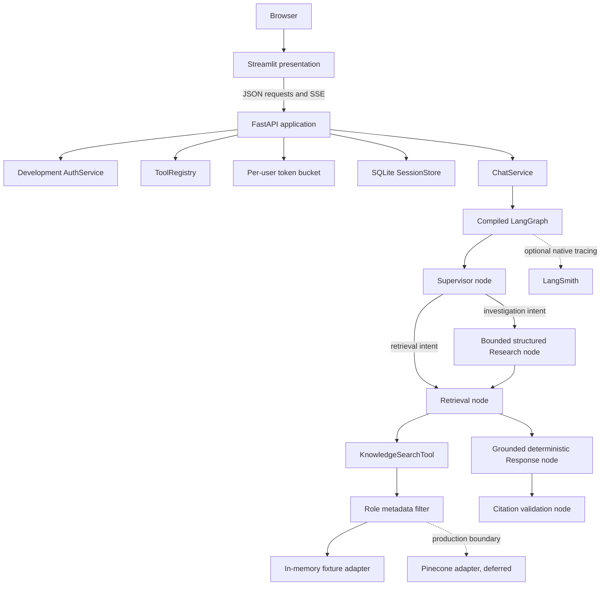

# Architecture

## Deployment shape

This repository is a modular monolith. The FastAPI and Streamlit entrypoints may run as separate OS/container processes, while sharing one Python package, one dependency lock, and one coordinated Compose setup. The domain, retrieval, memory, security, tools, agents, and observability modules are internal boundaries and are not independent services.

## Request path

1. FastAPI validates the request, assigns a request ID, resolves the bearer token to a server-side user and role, checks session ownership, and consumes one rate-limit token.
2. The user message is stored in SQLite before the response stream begins.
3. `ChatService` asynchronously consumes `CompiledStateGraph.astream(..., stream_mode="updates")`. Each event in a graph node update becomes an `ActivityEvent`; activity is tied to actual node execution.
4. Supervisor selects a direct retrieval route or one bounded Research planning step. Both paths reach one access-controlled knowledge search, a deterministic grounded response, and citation validation.
5. FastAPI streams each event using the stable SSE schema. The assistant turn is persisted after successful graph completion.

Structured events expose route choice, agent/node changes, tool status, source IDs/titles, response chunks, citation validation, memory updates, and failures. They do not expose private model chain-of-thought. Production model input/output tracing requires an explicit data review and redaction plan.

## Internal contracts

- `domain.models` validates chunk metadata and citations.
- `retrieval.interfaces.Retriever` defines the role-filtered search boundary. Document loading, chunking, embedding, sparse search, and ranking are separate protocols.
- `tools.registry.ToolRegistry` checks server-resolved roles before invoking a backend handler. Prompt text and frontend controls are not authorization.
- `memory.interfaces.SessionStore` isolates every operation by owner. `SQLiteSessionStore` is the local adapter.
- `agents.state.AgentState` is the typed LangGraph state; `agents.graph` compiles its transitions.
- `observability.events.ActivityEvent` is shared by graph updates, SSE, and the UI.

## Retrieval and citations

The local adapter filters `access_level` before ranking and returning chunk content. The graph only receives results returned for the authenticated role. The mock score is lexical and suitable only for deterministic demos. The planned Pinecone strategy is separate dense and sparse top-k retrieval followed by reciprocal-rank fusion, `sum(1 / (k + rank))`; RRF avoids assuming raw dense and BM25 scores are comparable. Metadata filtering must be applied in the vector query before returning text. Citation validation requires each marker's document/chunk pair to match evidence retrieved on that turn.

## Bounded research and failure behavior

Research uses `SearchPlan` and `ExecutionBudget`; validated query strings are interpreted by approved search functions. There is no `exec`, `eval`, shell, or model-controlled filesystem access. The graph currently permits one search call and a depth of one. A node failure is converted into a generic failure event, and no assistant answer is persisted. User content and provider exception text are excluded from application logs.

When adding recursive work, enforce shared depth, search-call, document, and wall-clock budgets; deduplicate tool calls by normalized query and filter; retry only classified transient failures with a small cap; and terminate the turn after the cap rather than looping or fanning out across unbounded subtasks. A LangGraph checkpointer can be supplied at `graph.compile(checkpointer=...)`; a human approval interrupt can be added around future high-impact tools.

## Process and state boundaries

SQLite session messages survive API restarts. Login tokens and rate-limit buckets are in process memory and do not coordinate across workers. A single API process is the supported local topology. The UI calls the API for all session, chat, and retrieval behavior.
