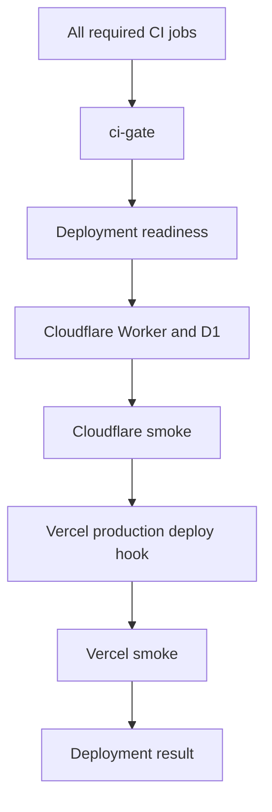

# Continuous integration and automatic deployment

## Current deployment state

Cloudflare and Vercel deployment starts automatically when every required CI
job passes on `main`. Those deploys are skipped for pull requests, scheduled
runs, stale releases, and unsuccessful CI. Streamlit Community Cloud follows
`main` and rebuilds independently of CI. Provider credentials and target
settings must exist in the `production` environment.

The `.github/workflows/ci.yml` workflow owns CI and deployment. Pull requests
and scheduled runs validate code only. A push to `main` triggers Cloudflare
and Vercel deployment after the same run passes the complete CI gate. A
manual dispatch runs those CI checks before evaluating deployment readiness.

## CI checks and gate

`.github/workflows/ci.yml` keeps independent jobs for lint, formatting,
docblocks, comments, line length, syntax, package build, type checking,
dependency audit, Python 3.12/3.13/3.14 tests, Worker/D1,
GitHub Actions syntax, deployment configuration, and Docker Compose API
smoke.
The `ci-gate` job depends on all required checks and fails for any result
other than `success`, including `cancelled` and `skipped`.



The `readiness` job uses the result of `ci-gate` from this run. Pushes to
`main` pushes and manual dispatches on `main` are the only deployment
triggers. Scheduled runs, pull requests, failed or cancelled CI, stale
commits, and non-main manual runs cannot authorize deployment. There is no
deployment opt-in flag.

All workflow runs use a non-cancelling concurrency group, so an in-progress
main release is not cancelled by a newer push. Cloudflare migrations,
Worker deployment, and Vercel hook triggering recheck release freshness
before their remote changes.

## Local Wrangler commands

Node.js 22 or newer and npm are required. Wrangler is pinned to 4.162.0 in
the Worker package and lock file. From the Worker directory:

```bash
cd infra/cloudflare/d1-gateway
npm ci
npm run validate-config
npm test
npm run typecheck
npm run migrate:local
npm run dev
```

The test command uses Wrangler's local D1 runtime and applies the test
migrations in an isolated database. `npm run test:integration` runs the
Worker integration suite. The root `make cloud-sim-test` also checks the
FastAPI adapter against a local Wrangler Worker. Copy `.dev.vars.example` to
`.dev.vars` for local credentials; the ignored local file must not be
committed.

`npm run migrations:remote:list`, `npm run migrate:remote`, and
`npm run deploy` are reserved for the GitHub deployment. The remote
mutation scripts reject local invocation and require CI authorization, a
current release SHA, the dedicated D1 identity, and production credentials.
The checked-in Wrangler file has a placeholder D1
ID. The workflow renders a separate ignored config from explicit account and
database IDs; it never copies identifiers from unrelated local Wrangler
state.

## GitHub setup

Create a GitHub environment named `production` and restrict its deployment
branch to `main`. Keep cloud credentials in this environment, not
repository-wide secrets. Production jobs receive only `contents: read`.

Set these variables on the `production` environment:

| Variable | Required value |
|---|---|
| `CLOUDFLARE_ACCOUNT_ID` | Account containing the dedicated Worker and D1. |
| `CLOUDFLARE_D1_DATABASE_ID` | ID for `eka-sessions` only. |
| `CLOUDFLARE_WORKER_URL` | HTTPS `workers.dev` URL for `eka-d1-gateway`. |
| `VERCEL_PROJECT_ID` | ID of the FastAPI Vercel project. |
| `VERCEL_PRODUCTION_URL` | Public HTTPS production API origin. |

Set these secrets on the `production` environment:

| Secret | Purpose |
|---|---|
| `CLOUDFLARE_API_TOKEN` | Deploy and migrate the dedicated Worker/D1. |
| `D1_SERVICE_TOKEN` | Same high-entropy token used by Worker and Vercel. |
| `VERCEL_DEPLOY_HOOK` | Trigger the production build after CI succeeds. |
| `SMOKE_ANALYST_PASSWORD` | Password for the synthetic Analyst smoke user. |
| `SMOKE_VIEWER_PASSWORD` | Password for the synthetic Viewer smoke user. |

The smoke passwords must match the dedicated synthetic users in Vercel's
`DEV_USERS_JSON`. Do not use a human account or customer data. The workflow
does not print secret values or provider response bodies.

The production API origin must be reachable by Streamlit Community Cloud and
the CI smoke without a bypass header. Keep API authentication enabled.

Use the existing dedicated D1 database named `eka-sessions`; create the
`eka-d1-gateway` Worker before enabling releases. This keeps the deployment
token from needing database deletion permissions. Scope
`CLOUDFLARE_API_TOKEN` to the existing Worker with Workers Scripts Edit, and
grant D1 Read and D1 Write for the database.
Do not grant route or custom-domain write access. The workflow checks the
returned D1 name and ID before any migration. Use an HTTPS `workers.dev`
hostname; custom route setup is outside this pipeline.
Cloudflare documents scoped Worker Editor permissions for deployment and
D1 Read/Write permissions for inspecting and applying migrations. Creating a
Worker in CI would require broader access, so the pipeline only updates the
pre-created Worker.

The Vercel project must use the repository root and `app.py` entrypoint.
`vercel.json` disables automatic Git deployments. Configure the deploy hook
for the `main` branch. Configure runtime settings in the Vercel Production
environment, including OpenAI, Pinecone, LangSmith, authentication,
`DEV_USERS_JSON`, and the D1 URL and service token. After CI passes, the
workflow triggers the hook and verifies the production API reports the
approved `VERCEL_GIT_COMMIT_SHA`.

For Streamlit Community Cloud, create the app with
`apps/ui/main.py` and the pinned dependencies in
`apps/ui/requirements.txt`. The UI defaults to the production Vercel API;
configure an `API_BASE_URL` override only for another target. Configure the
app to follow `main`. Community Cloud starts its rebuild after a main-branch
push. CI does not run browser or frontend smoke checks against Community
Cloud.

This setup deploys directly to the production Vercel origin through its
post-CI deploy hook and uses one production environment. It does not provision
a separate Cloudflare or Streamlit staging environment. Add isolated staging
accounts and resources before introducing a staging deployment lane.

## Release and smoke behavior

1. Cloudflare validates its isolated config, rejects destructive migration
   statements, confirms the exact D1 identity, lists pending migrations, and
   applies approved migrations. It deploys the Worker with a release SHA.
2. Cloudflare smoke checks public `/health`, authenticated `/internal/ready`,
   release identity, invalid-token rejection, and synthetic D1 read/write.
3. Vercel builds the exact main commit through its deploy hook. CI checks the
   production URL for health, readiness, version, authentication, session
   persistence, and user ownership isolation.
4. The final result job reports success only if Cloudflare and Vercel deploy
   and smoke jobs pass.

Release smoke tests use synthetic credentials and do not send model prompts.
D1 smoke records are synthetic and retained for auditability; the pipeline
does not delete production rows. The Compose check starts only FastAPI and
checks its health and readiness. Streamlit Community Cloud rebuilds from
`main`; CI does not start or probe the frontend.

## Recovery

- **Worker:** record the release SHA and use Cloudflare's version history to
  restore a prior Worker version. A code rollback does not reverse D1
  migrations. Add a new forward migration to repair schema changes.
- **Vercel:** promote the last known-good deployment in the Vercel dashboard
  or CLI.
- **Streamlit:** open a reviewed revert or forward-fix PR on `main` and let
  Community Cloud rebuild the app.
- **Cross-service:** keep API and D1 changes backward-compatible. Record the
  release SHA and Worker, Vercel, and UI revisions together. Do not roll back
  D1 automatically after a partial deployment.

No rollback command is run automatically. After a failed component or smoke
job, the workflow fails and prevents downstream deployment. Inspect the
redacted job summary and platform logs, repair forward or promote the last
known-good application release, then run the gated release process again.

## References

- [Wrangler D1 migration commands][wrangler-d1]
- [Cloudflare Worker authorization][cloudflare-auth]
- [Vercel Git deployment settings][vercel-git]
- [Vercel deployment hooks][vercel-hooks]
- [GitHub branch rulesets][github-rulesets]
- [Streamlit Community Cloud deployment][streamlit-cloud]

[wrangler-d1]: https://developers.cloudflare.com/workers/wrangler/commands/d1/
[cloudflare-auth]: https://developers.cloudflare.com/workers/authorization/
[vercel-git]: https://vercel.com/docs/project-configuration/git-configuration
[vercel-hooks]: https://vercel.com/docs/deploy-hooks
[github-rulesets]: https://docs.github.com/en/repositories/configuring-branches-and-merges-in-your-repository/managing-rulesets/creating-rulesets-for-a-repository
[streamlit-cloud]: https://docs.streamlit.io/deploy/streamlit-community-cloud/deploy-your-app/deploy
