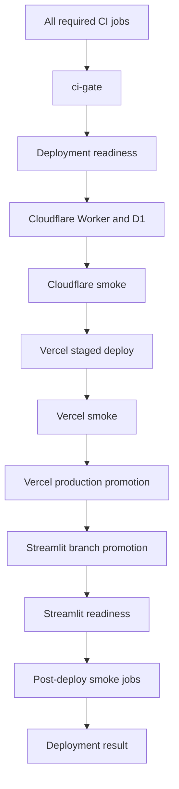

# Continuous integration and gated deployment

## Current deployment state

Production deployment is deliberately blocked until repository variables,
production secrets, cloud resources, and GitHub environment protection are
configured. `DEPLOY_ENABLED` and `RUN_LIVE_E2E_SMOKE` must both be the string
`true` before a deployment is authorized. They are currently not enabled by
this implementation. No cloud deployment was run as part of this change.

The `.github/workflows/ci.yml` workflow owns both CI and the gated deployment
jobs. Pull requests and scheduled runs validate code only. A push to `main`
can deploy only after the same run passes the complete CI gate. A manual
dispatch runs those CI checks before evaluating deployment readiness.

## CI checks and gate

`.github/workflows/ci.yml` keeps independent jobs for lint, formatting,
docblocks, comments, line length, syntax, package build, type checking,
dependency audit, Python 3.12/3.13/3.14 tests, Worker/D1, Streamlit startup,
GitHub Actions syntax, deployment configuration, and Docker Compose smoke.
The `ci-gate` job depends on all required checks and fails for any result
other than `success`, including `cancelled` and `skipped`.



The `readiness` job uses the result of `ci-gate` from this run. Pushes to
`main` and manual dispatches on `main` are the only deployment triggers.
Scheduled runs, pull requests, failed or cancelled CI, stale commits, and
non-main manual runs cannot authorize deployment. A deployment is also
skipped unless both opt-ins are true. When they are disabled, readiness
reports the blockers in the workflow summary while the successful CI gate
remains green.

All workflow runs use a non-cancelling concurrency group, so an in-progress
main release is not cancelled by a newer push. Cloudflare migrations and
Worker deployment, Vercel promotion, and the Streamlit branch push recheck
release freshness immediately before making their remote change.

## Local Wrangler commands

Node.js 22 or newer and npm are required. Wrangler is pinned to 4.162.0 in
the Worker package and lock file. From the Worker directory:

```bash
cd infra/cloudflare/d1-gateway
npm ci
npm run validate-config
npm test
npm run typecheck
npm run migrate:local
npm run dev
```

The test command uses Wrangler's local D1 runtime and applies the test
migrations in an isolated database. `npm run test:integration` runs the
Worker integration suite. The root `make cloud-sim-test` also checks the
FastAPI adapter against a local Wrangler Worker. Copy `.dev.vars.example` to
`.dev.vars` for local credentials; the ignored local file must not be
committed.

`npm run migrations:remote:list`, `npm run migrate:remote`, and
`npm run deploy` are reserved for the gated GitHub deployment. The remote
mutation scripts reject local invocation and require CI authorization,
both opt-ins, a current release SHA, the dedicated D1 identity, and protected
production credentials. The checked-in Wrangler file has a placeholder D1
ID. The workflow renders a separate ignored config from explicit account and
database IDs; it never copies identifiers from unrelated local Wrangler
state.

## GitHub setup

Create a protected GitHub environment named `production`. Require reviewer
approval, prevent self-review where the repository plan supports it, and
restrict deployments to `main`. Keep cloud credentials in this environment,
not repository-wide secrets. Give the production jobs only `contents: read`;
the Streamlit promotion job alone receives `contents: write`.

Set these repository variables before attempting a release:

| Variable | Required value |
|---|---|
| `DEPLOY_ENABLED` | Keep `false` until setup and approvals are complete. |
| `RUN_LIVE_E2E_SMOKE` | Keep `false` until one model call is approved. |
| `CLOUDFLARE_ACCOUNT_ID` | Account containing the dedicated Worker and D1. |
| `CLOUDFLARE_D1_DATABASE_ID` | ID for `eka-sessions` only. |
| `CLOUDFLARE_WORKER_URL` | HTTPS `workers.dev` URL for `eka-d1-gateway`. |
| `VERCEL_ORG_ID` | Vercel team or account ID used by the CLI. |
| `VERCEL_PROJECT_ID` | ID of the FastAPI Vercel project. |
| `VERCEL_PRODUCTION_URL` | Public HTTPS production API origin. |
| `STREAMLIT_URL` | HTTPS Community Cloud app origin. |
| `STREAMLIT_BRANCH` | Exactly `deploy/streamlit`. |

Set these secrets on the `production` environment:

| Secret | Purpose |
|---|---|
| `CLOUDFLARE_API_TOKEN` | Deploy and migrate the dedicated Worker/D1. |
| `D1_SERVICE_TOKEN` | Same high-entropy token used by Worker and Vercel. |
| `VERCEL_TOKEN` | Deploy, inspect, and promote this Vercel project. |
| `VERCEL_AUTOMATION_BYPASS_SECRET` | Let CI test a protected Vercel URL. |
| `SMOKE_ANALYST_PASSWORD` | Password for the synthetic Analyst smoke user. |
| `SMOKE_VIEWER_PASSWORD` | Password for the synthetic Viewer smoke user. |

The smoke passwords must match the dedicated synthetic users in Vercel's
`DEV_USERS_JSON`. Do not use a human account or customer data. The workflow
does not print secret values or provider response bodies.

Keep Vercel Deployment Protection on staged deployment URLs and let CI use
the automation bypass secret there. The stable production API origin must be
reachable by Streamlit Community Cloud without that bypass header; Streamlit
does not receive the Vercel bypass secret. Keep API authentication enabled.

Use the existing dedicated D1 database named `eka-sessions`; create the
`eka-d1-gateway` Worker before enabling releases. This keeps the deployment
token from needing database deletion permissions. Scope
`CLOUDFLARE_API_TOKEN` to the existing Worker with Workers Scripts Edit, and
grant D1 Read and D1 Write for the database.
Do not grant route or custom-domain write access. The workflow checks the
returned D1 name and ID before any migration. Use an HTTPS `workers.dev`
hostname; custom route setup is outside this pipeline.
Cloudflare documents scoped Worker Editor permissions for deployment and
D1 Read/Write permissions for inspecting and applying migrations. Creating a
Worker in CI would require broader access, so the pipeline only updates the
pre-created Worker.

The Vercel project must use the repository root and `app.py` entrypoint.
`vercel.json` disables Git-triggered deployments. Configure runtime secrets
and settings in the Vercel Production environment, including OpenAI,
Pinecone, LangSmith, authentication, `DEV_USERS_JSON`, and the D1 URL and
service token. The pipeline stages a production build without assigning the
production domain, smoke-tests its unique URL, then promotes that candidate.
The workflow records the previous production alias for recovery.
Create a Vercel Protection Bypass for Automation secret and store it as the
GitHub `VERCEL_AUTOMATION_BYPASS_SECRET`; CI sends it only as an HTTP header
when testing the staged deployment URL.

For Streamlit Community Cloud, create the app manually with
`apps/ui/main.py` and the pinned dependencies in
`apps/ui/requirements.txt`. The UI defaults to the production Vercel API;
configure an `API_BASE_URL` override only for another target. Configure the
app to follow `deploy/streamlit`. Before enabling production, initialize the
branch from a known-good `main` commit. Protect it so normal users cannot push
or merge to it. After bootstrap, only the gated Actions workflow should
advance it. Use a ruleset to restrict updates to the GitHub Actions app.
If repository rules block the default Actions token, use a GitHub App
installation token for this job; do not weaken branch protection.
The app displays its checked-out Git SHA. Actions polls for the exact release
and checks the login, chat, and activity panel after promotion.

This setup has a staged Vercel candidate and a single protected production
environment. It does not provision a separate Cloudflare or Streamlit
staging environment. Add isolated staging accounts and resources before
introducing a staging deployment lane.

## Release and smoke behavior

1. Cloudflare validates its isolated config, rejects destructive migration
   statements, confirms the exact D1 identity, lists pending migrations, and
   applies approved migrations. It deploys the Worker with a release SHA.
2. Cloudflare smoke checks public `/health`, authenticated `/internal/ready`,
   release identity, invalid-token rejection, and synthetic D1 read/write.
3. Vercel builds and stages the exact SHA with production runtime settings.
   Its unique URL is checked for health, readiness, version, authentication,
   session persistence, and user ownership isolation.
4. The verified Vercel candidate is promoted. Actions then advances
   `deploy/streamlit` with a normal fast-forward push, never force-push.
5. Streamlit readiness waits up to fifteen bounded attempts for the exact
   SHA. Separate post-deployment jobs then check Worker, API, UI, and one
   full-stack synthetic conversation.
6. The final result job reports success only if every required stage passes.

The end-to-end test sends one live model-backed prompt per authorized
deployment. It is intentionally gated by `RUN_LIVE_E2E_SMOKE=true`; enabling
it can incur model usage charges. D1 smoke records are synthetic and retained
for auditability; the pipeline does not delete production rows.

The post-deployment jobs use the release SHA and verified service URLs from
earlier jobs in the same workflow. Their individual component checks and
end-to-end check fail closed. The end-to-end check confirms the displayed
API/Streamlit release, synthetic
Analyst login, a visible response and agent activity, persisted chat history,
the expected runbook citation and key instructions, and Viewer denial for the
Analyst's session. Streamlit Community Cloud does not provide a deployment
status API here; readiness is established by the visible source SHA and
browser behavior, not by an internal platform state.

## Recovery

- **Worker:** record the release SHA and use Cloudflare's version history to
  restore a prior Worker version. A code rollback does not reverse D1
  migrations. Add a new forward migration to repair schema changes.
- **Vercel:** use the recorded previous production alias/deployment in the
  Vercel dashboard or CLI to promote the last known-good deployment.
- **Streamlit:** open a reviewed revert or forward-fix PR on `main`; after
  CI passes, the normal workflow advances the deploy branch. Do not force
  push the deployment branch.
- **Cross-service:** keep API and D1 changes backward-compatible. Record the
  release SHA and Worker, Vercel, and UI revisions together. Do not roll back
  D1 automatically after a partial deployment.

No rollback command is run automatically. After a failed component or smoke
job, the workflow fails and prevents downstream deployment. Inspect the
redacted job summary and platform logs, repair forward or promote the last
known-good application release, then run the gated release process again.

## References

- [Wrangler D1 migration commands][wrangler-d1]
- [Cloudflare Worker authorization][cloudflare-auth]
- [Vercel Git deployment settings][vercel-git]
- [Vercel staged deployment and promotion][vercel-cli]
- [Vercel automation bypass][vercel-bypass]
- [GitHub branch rulesets][github-rulesets]
- [Streamlit Community Cloud deployment][streamlit-cloud]

[wrangler-d1]: https://developers.cloudflare.com/workers/wrangler/commands/d1/
[cloudflare-auth]: https://developers.cloudflare.com/workers/authorization/
[vercel-git]: https://vercel.com/docs/project-configuration/git-configuration
[vercel-cli]: https://vercel.com/docs/cli/deploy
[vercel-bypass]: https://vercel.com/docs/deployment-protection/methods-to-bypass-deployment-protection/protection-bypass-automation
[github-rulesets]: https://docs.github.com/en/repositories/configuring-branches-and-merges-in-your-repository/managing-rulesets/creating-rulesets-for-a-repository
[streamlit-cloud]: https://docs.streamlit.io/deploy/streamlit-community-cloud/deploy-your-app/deploy
