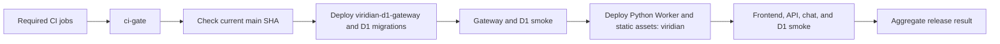

# CI/CD operations

`.github/workflows/ci.yml` is the only workflow. Pull requests and scheduled
runs receive no production secrets. A production release starts only after
the complete CI gate succeeds on the current `main` commit, or after a
manual dispatch of this same workflow on `main`.

## Production environment

Create a GitHub Environment named `production` and restrict it to the
`main` branch. Set the following variables:

| Variable | Required value |
|---|---|
| `CLOUDFLARE_ACCOUNT_ID` | `b927bb5a175968756829a888953afd71` |
| `CLOUDFLARE_D1_DATABASE_ID` | UUID of `viridian-sessions`. |
| `CLOUDFLARE_D1_GATEWAY_URL` | D1 gateway origin. |
| `CLOUDFLARE_API_URL` | Viridian API origin. |

Set these production secrets:

| Secret | Use |
|---|---|
| `CLOUDFLARE_API_TOKEN` | Cloudflare Workers and D1 deployment permissions. |
| `D1_SERVICE_TOKEN` | Same high-entropy token on both Viridian Workers. |
| `AUTH_SIGNING_SECRET` | At least 32 characters; signs API access tokens. |
| `SMOKE_ANALYST_PASSWORD` | Must match the public synthetic Analyst account. |
| `SMOKE_VIEWER_PASSWORD` | Must match the public synthetic Viewer account. |
| `SMOKE_ADMIN_PASSWORD` | Public synthetic Administrator account. |

The demo passwords are intentionally public and synthetic. Never use them
for another account. Rotate the Cloudflare API token, D1 token, and signing
secret through their respective secret stores; do not put values in the
repository or workflow command lines.

## What the workflow checks

The required gate includes lint, formatting, package build, Python tests and
type checking, Python and npm dependency audits, D1 Worker tests and types,
Docker Compose API smoke, workflow syntax, and static deployment
configuration validation. The 3.12–3.14 Python matrix remains in place;
the Cloudflare Python Worker toolchain is installed on Python 3.13.

After CI passes, deployment jobs recheck that the approved SHA is still the
tip of `main`. The D1 job verifies the exact database name and ID, rejects
unsafe migrations, applies reviewed forward-only migrations, and deploys the
authenticated gateway. The API job builds the Python Worker with Pywrangler,
loads its secrets through a restricted one-shot file, and publishes the
frontend and FastAPI backend together.

Smoke checks verify gateway authentication and database writes, then verify
the Viridian static assets, health/version/readiness, mock provider mode,
login, role identity, cross-owner isolation, streamed chat completion, and
persisted session messages. They use only synthetic data. The final job fails
if either Worker deployment or any smoke check fails.

## Free production profile

The Wrangler API configuration pins the application to fixture retrieval,
mock answers, and disabled LangSmith tracing. No OpenAI or Pinecone secrets
are deployed. The deployment uses the Free Workers runtime, Workers Static
Assets, and D1; it does not enable Containers, paid Worker CPU, or other paid
Cloudflare products. Static asset delivery and API requests share the
`viridian` Worker.

Cloudflare Free limits still apply to API requests and D1 storage/query
usage. Requests that exceed those limits fail rather than switching the
account to a paid plan. The production smoke checks demonstrate the selected
routes and synthetic data path; they are not a capacity benchmark.

## Failure handling

- **CI gate:** Fix the failed check and push a new commit. Deploy jobs do not
  run after a failure, cancellation, skip, or stale release SHA.
- **D1 migration:** Stop before applying changes if the database identity
  differs or a migration is destructive. Prepare a forward-only migration.
- **D1 gateway smoke:** The API deploy is blocked until the gateway can
  authenticate and persist synthetic records.
- **API deployment or smoke:** The aggregate result fails. Inspect the
  relevant GitHub Actions step, then push a correction through the same gate.
- **Rollback:** Use Cloudflare Worker versions to roll back code, then rerun
  the smoke checks. A Worker code rollback does not roll back D1 data.

Only Cloudflare resources participate in the production workflow. The local
Streamlit client is not deployed by GitHub Actions.
