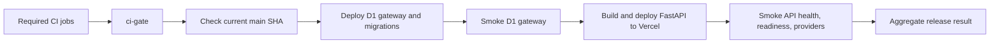

# CI/CD operations

`.github/workflows/ci.yml` is the release workflow. Pull requests and
scheduled runs receive no production secrets. Production deploys start only
after the complete `ci-gate` succeeds for the current `main` commit, or after
a manual dispatch of this workflow on `main`.

## Production environment

Create a GitHub Environment named `production` and restrict it to `main`.
Set these variables:

| Variable | Purpose |
|---|---|
| `CLOUDFLARE_ACCOUNT_ID` | Account that owns the D1 gateway. |
| `CLOUDFLARE_D1_DATABASE_ID` | UUID for `viridian-sessions`. |
| `CLOUDFLARE_D1_GATEWAY_URL` | D1 gateway origin. |
| `VERCEL_ORG_ID` | Vercel team ID for Viridian. |
| `VERCEL_PROJECT_ID` | Vercel project ID for Viridian. |
| `VERCEL_API_URL` | `https://viridian-api.vercel.app`. |

Set these secrets:

| Secret | Purpose |
|---|---|
| `CLOUDFLARE_API_TOKEN` | Deploy the D1 gateway and apply D1 migrations. |
| `D1_SERVICE_TOKEN` | Shared service credential used by the API and gateway. |
| `VERCEL_TOKEN` | Lets the production job pull, build, and deploy. |

Provider and authentication credentials stay in Vercel's production
environment. GitHub Actions does not pull these sensitive values into the
deployment job. Keep the Cloudflare token limited to the Viridian Worker and
D1 resources.

## What the workflow checks

The required gate includes lint, formatting, package build, Python tests and
type checking, Python and npm dependency audits, D1 Worker checks, Docker
Compose API smoke, workflow syntax, and deployment configuration. The Python
matrix covers 3.12–3.14; the Vercel build uses Python 3.12 and the locked
dependency set.

After CI passes, readiness confirms the approved SHA is still the tip of
`main`. The D1 job validates the database identity, rejects unsafe
migrations, applies reviewed forward-only migrations, and deploys the
authenticated gateway. Its smoke verifies authentication and D1 read/write.
Only then does the workflow build and deploy the FastAPI project to Vercel.
The Vercel smoke checks health, D1 readiness, and the configured OpenAI and
Pinecone providers. A final job fails the release if any deployment or smoke
step did not succeed. LangSmith delivery can be checked locally with
`make verify-langsmith` when a LangSmith key is available.

`vercel.json` disables Vercel's automatic Git deployments so a push cannot
bypass `ci-gate`. The CI job uses a pinned Vercel CLI version and the exact
commit approved by the gate.

Streamlit Cloud remains connected to the repository and deploys UI changes
from its configured branch independently of this workflow. It is not
triggered by a GitHub Actions deploy command.

## Failure handling

- **CI gate:** Fix the failed check and push a new commit. Deployment jobs do
  not run after a failed, canceled, skipped, or stale gate.
- **D1 migration or smoke:** The Vercel API deploy is blocked until the D1
  gateway is healthy.
- **Vercel credentials:** Add `VERCEL_TOKEN` to the `production` environment;
  configure the non-secret Vercel IDs as environment variables.
- **Vercel deployment or smoke:** Inspect the named deployment step in the
  GitHub Actions run, then push a correction through the same gate.
- **Rollback:** Roll back the Vercel API deployment and, separately, the D1
  gateway Worker version. A Worker code rollback does not roll back D1 data.
