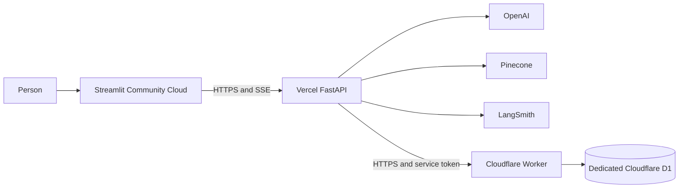

# Multi-cloud deployment guide

This repository prepares one FastAPI and LangGraph backend, one Streamlit
frontend, and a small Cloudflare Worker that stores sessions in D1. AI,
retrieval, role checks, and LangSmith tracing remain in FastAPI. The Worker
only implements the private session-storage contract.



No cloud project, Worker, or D1 database was created for this preparation.
The local Worker tests use Wrangler's isolated local runtime and a temporary
D1 database. See the official [Vercel FastAPI guide][vercel-fastapi],
[Python runtime][vercel-python], [Streamlit dependency guide][streamlit-deps],
[Streamlit deployment guide][streamlit-deploy], and
[Cloudflare Wrangler configuration][wrangler-config].

## Supported profiles

| Profile | AI and retrieval | Store | Credentials |
|---|---|---|---|
| Local mock | Deterministic mock | SQLite | None after setup |
| Local live | OpenAI + Pinecone | SQLite | Provider keys; optional LangSmith |
| Cloud | OpenAI + Pinecone | Worker + D1 | Provider and auth secrets |

The backend reads `.env` and process variables. Local defaults remain
`APP_ENV=development`, `MOCK_MODE=true`, `LLM_PROVIDER=mock`, and
`MEMORY_BACKEND=sqlite`. To use live providers locally, set
`MOCK_MODE=false`, `LLM_PROVIDER=openai`, and configure OpenAI and Pinecone
in the API environment. LangSmith remains an explicit backend setting.

Production settings fail closed unless they include a D1 Worker URL and
service token, an authentication signing secret, inline `DEV_USERS_JSON`,
OpenAI and Pinecone credentials, a Pinecone index name, LangSmith tracing
and key, live OpenAI mode, and explicit HTTPS CORS origins. Use synthetic
development accounts only. Never place backend credentials in Streamlit
settings.

## Local setup

Start the existing SQLite-based application with:

```bash
uv sync --all-groups --extra ui
make setup
make dev
```

To run all three services and local D1 in Docker Compose, first use a local
`.env.cloud-sim` generated from `.env.cloud-sim.example`:

```bash
make cloud-sim
```

The simulation uses mock AI and synthetic fixture documents. The API and
Worker share only the local service token, the API receives a local signing
key, and the Streamlit container receives only `API_BASE_URL`. The named D1
volume persists across `make cloud-sim-down`; that command does not delete
the volume. Remove the volume manually only if you want to erase local demo
conversations.

The Python integration test starts Wrangler in local mode, applies migrations
to a disposable temporary database, logs an Analyst in, runs a real
LangGraph mock turn through FastAPI, verifies history after creating a
second API instance, checks that a Viewer gets 404 for the Analyst's session,
and confirms safe readiness behavior after the Worker stops:

```bash
cd infra/cloudflare/d1-gateway
npm ci
cd ../..
make cloud-sim-test
```

This test does not contact a Cloudflare account. `npm test` separately runs
the Worker routes against the local D1 emulator. `npm run typecheck` checks
the Worker and its tests.

## Vercel: FastAPI and LangGraph

1. Create a Vercel project from the existing GitHub repository and select the
   repository root as the project root.
2. Keep the default Python build detection. The root `app.py` imports and
   exposes the same `create_app()` instance used by `apps/api/main.py`.
   `vercel.json` sets a 60-second Function duration. `.vercelignore` omits
   UI, test, fixture, documentation, and infrastructure files.
3. Set the production environment variables below in Vercel's project
   settings. Do not add them to the repository or a frontend deployment.
4. Set the D1 URL to the dedicated Worker URL after that Worker is deployed.
   Set `CORS_ORIGINS` to explicit HTTPS origins. The Streamlit client makes
   server-side HTTP requests, so browser CORS does not protect those calls.
5. Deploy only after the Cloudflare Worker and migrations are ready. Check
   `/health` for process liveness and `/ready` for D1 reachability.

Set at least:

```dotenv
APP_ENV=production
MOCK_MODE=false
LLM_PROVIDER=openai
MEMORY_BACKEND=d1
D1_API_URL=https://<dedicated-worker-host>
D1_SERVICE_TOKEN=<same-random-token-as-worker-secret>
AUTH_SIGNING_SECRET=<random-secret-of-at-least-32-characters>
AUTH_ISSUER=enterprise-knowledge-assistant
AUTH_AUDIENCE=enterprise-knowledge-assistant-api
DEV_USERS_JSON=<inline-json-for-synthetic-demo-users>
OPENAI_API_KEY=<backend-only-key>
PINECONE_API_KEY=<backend-only-key>
PINECONE_INDEX_NAME=<existing-index-name>
PINECONE_NAMESPACE=<synthetic-assessment-namespace>
LANGSMITH_TRACING=true
LANGSMITH_API_KEY=<backend-only-key>
CORS_ORIGINS=["https://<streamlit-app-host>"]
```

Production `DEV_USERS_JSON` must be inline JSON because the Vercel Function
does not depend on the local user file. Its password fields are plain demo
password strings, so configure synthetic assessment accounts only. The
backend still assigns roles from this configuration; clients cannot provide
roles. Use a real identity provider before accepting real users.

The project requires Python 3.12 through 3.14. Vercel documents FastAPI as
an ASGI deployment and documents a 500 MB uncompressed Function bundle
limit; deployment platform limits and duration vary by plan. A clean local
`uv sync --no-dev` for Python 3.13 installed 61 MB of runtime packages. This
is a dependency-size estimate, not a Vercel bundle artifact. Check the
resolved deployment bundle before a future deployment. The handler streams
validated answer chunks and graph activity, not token-by-token model output.
Research is bounded, but a slow provider can still exceed the configured
Function duration. See [Vercel FastAPI][vercel-fastapi] and the
[Python runtime limits][vercel-python].

Troubleshooting:

- A startup configuration error lists required variable names, never their
  values. Check Vercel environment scope and redeploy after changing settings.
- `/health` can succeed while `/ready` fails; the latter checks only D1.
- A Worker error maps to a generic 503. Check Worker logs without copying
  service tokens into logs.
- A 401 from `/api/v1/auth/token` indicates a demo credential mismatch.
- A timeout may be an OpenAI, Pinecone, D1, Research-budget, or Function
  duration limit; use request IDs and sanitized server logs to investigate.

## Streamlit Community Cloud: frontend

1. Create a Streamlit Community Cloud app from the same GitHub repository
   and branch.
2. Set the main file to `apps/ui/main.py` and the Python version to 3.12.
3. Streamlit finds `apps/ui/requirements.txt` in the app directory. It
   contains only `streamlit` and `httpx`, so the UI does not install the
   backend's OpenAI, Pinecone, LangSmith, or Cloudflare dependencies.
4. After Vercel is deployed, add the public API base URL as a Streamlit
   secret:

   ```toml
   API_BASE_URL = "https://<vercel-api-host>"
   ```

   The same public value can be set as an environment variable. The app
   reads the environment first, then Streamlit secrets. The optional local
   `.streamlit/secrets.toml.example` shows the format. Never add API keys,
   D1 service credentials, or the authentication signing key here.
5. Restart the Streamlit app and verify sign-in, session creation, history,
   and an SSE chat request against the API.

The Streamlit app keeps the bearer token and selected session in
`st.session_state` for that active frontend session. Conversation history
comes from the FastAPI storage API, so an API process restart does not erase
D1 history. A new UI session does not automatically discover old sessions;
retain or share the session ID, or add an owner-scoped session listing before
requiring cross-session discovery.

Streamlit documents app-local dependency files, repository and entrypoint
selection, and its secrets manager in the
[dependency guide][streamlit-deps], [deployment guide][streamlit-deploy],
and [secrets guide][streamlit-secrets].

Troubleshooting:

- A blank chat input before sign-in is expected; authenticate first.
- A connection error usually means `API_BASE_URL` is missing, misspelled,
  or points to an API that is not ready.
- The UI shows caller-safe errors. Inspect API request IDs and service logs
  rather than surfacing backend exception text to users.
- The public hostname can be included in backend `CORS_ORIGINS` for any
  future browser-based client. Streamlit's Python HTTP requests are
  server-to-server and are not governed by browser CORS.

## Cloudflare Workers and D1: session storage

Create a new D1 database specifically for this assessment. Do not select or
reuse another database in the account. The checked-in
`infra/cloudflare/d1-gateway/wrangler.jsonc` uses a fake placeholder ID and
must not be pointed at an existing resource.

For a future live setup:

1. Install Node.js 22 or later, then install the locked Worker dependencies
   with `npm ci` in `infra/cloudflare/d1-gateway`.
2. Create a dedicated D1 database from the Cloudflare dashboard or with
   Wrangler. Set its returned database ID in a private local copy of
   `wrangler.jsonc`; do not commit the real account-specific ID.
3. Apply the checked-in, non-destructive migrations to that new database:

   ```bash
   npx wrangler d1 migrations apply eka-assessment-d1 --remote
   ```

   This is a future deployment command. It was not run during this work.
4. Generate a high-entropy service token and store the same value in the
   Worker secret and Vercel `D1_SERVICE_TOKEN`. Add it to the Worker with
   `npx wrangler secret put D1_SERVICE_TOKEN`; enter the value at the prompt.
5. Deploy the Worker from this directory with `npm run deploy`. Then set the
   Worker URL as Vercel `D1_API_URL` and verify `/ready` from FastAPI.
6. Confirm that D1 reads and writes only through this Worker's authenticated
   endpoints. Do not use Cloudflare's administrative D1 API at runtime.

For local development, copy `.dev.vars.example` to `.dev.vars`, replace the
placeholder with a local-only token, apply migrations with `--local`, then
run `wrangler dev --local`. Or use `make cloud-sim` to start the Worker, D1,
FastAPI, and Streamlit together. Do not pass `--remote` during local tests.

Every Worker request requires a bearer service token. The Worker scopes each
read and write by the `X-Owner-ID` supplied by FastAPI after token
verification. The Worker returns the same 404 for a missing or foreign
session and uses prepared SQL statements. It exposes no arbitrary SQL route.
The API adapter reuses an async HTTP client, validates responses, sets
timeouts, and maps provider details to safe errors.

Wrangler documents local D1 state and migrations in its
[D1 migration guide][d1-migrations] and local testing in the
[Vitest integration guide][cloudflare-vitest]. The local emulator does not
prove remote credentials, remote D1 availability, Worker deployment, or
production latency.

Troubleshooting:

- Wrangler local development reads secrets from `.dev.vars`; see
  [Cloudflare local environment variables][cloudflare-secrets].
- `database_not_ready` means migrations were not applied to the selected
  database. Check the binding name and migration history.
- A service-token mismatch returns 401. Rotate both Vercel and Worker values
  together and never paste them into issue reports.
- Use a new database for schema experiments. The included migration creates
  the expected tables and indexes without dropping existing data.

## Configuration ownership

| Setting | Vercel API | Streamlit UI | Cloudflare Worker |
|---|---:|---:|---:|
| `OPENAI_API_KEY` | Yes | No | No |
| `PINECONE_API_KEY` | Yes | No | No |
| `LANGSMITH_API_KEY` | Yes | No | No |
| `AUTH_SIGNING_SECRET` | Yes | No | No |
| `D1_SERVICE_TOKEN` | Yes | No | Yes |
| `D1_API_URL` | Yes | No | No |
| `API_BASE_URL` | No | Yes | No |
| D1 database binding ID | No | No | Private Wrangler config |

`.env.example` describes the backend settings. `.streamlit/secrets.toml.example`
contains only the public API URL. `.env.cloud-sim.example` contains
disposable local values; it is not a production template. The root `.gitignore`
excludes real `.env` files, Cloudflare `.dev.vars`, local account files,
generated D1 state, and `docs/assignment.md` and `docs/plan.md`.

## Cost and operating limits

These platforms have changing free plans and quotas; verify current plan
terms before launch. A free hosting tier does not make every connected
service free. OpenAI API inference can incur usage charges. Pinecone and
LangSmith limits depend on the selected account and plan. The demonstration
uses synthetic content and modest request sizes; it has no distributed rate
limiter, identity provider, session-list endpoint, or production SLO.

The design uses Vercel for request-scoped Python ASGI execution, Streamlit
Community Cloud for the existing Python presentation layer, Cloudflare
Workers as a small authenticated D1 gateway, and signed bearer tokens so
identity verification does not depend on a particular API process. D1
replaces a local SQLite file only for deployed session persistence; it does
not replace FastAPI or host model and retrieval logic.

Stateless bearer tokens cannot be revoked individually before expiry. Use a
short lifetime, rotate the signing secret to invalidate all tokens, and
replace development login with a reviewed identity provider before real
users or sensitive information.

## Verification status

Local unit, Worker, and optional Wrangler/D1 integration tests exercise the
configured boundaries. CI runs a separate Worker and local-D1 job alongside
Python tests and the existing Docker Compose smoke test. No Vercel build or
deployment, Streamlit Cloud app, remote Worker, or remote D1 migration has
been run. A real provider configuration and account-specific D1 ID remain
required before any live deployment can be verified.

[vercel-fastapi]: https://vercel.com/docs/frameworks/backend/fastapi
[vercel-python]: https://vercel.com/docs/functions/runtimes/python
[streamlit-deps]: https://docs.streamlit.io/deploy/streamlit-community-cloud/deploy-your-app/app-dependencies
[streamlit-deploy]: https://docs.streamlit.io/deploy/streamlit-community-cloud/deploy-your-app/deploy
[streamlit-secrets]: https://docs.streamlit.io/deploy/streamlit-community-cloud/deploy-your-app/secrets-management
[wrangler-config]: https://developers.cloudflare.com/workers/wrangler/configuration/
[cloudflare-secrets]: https://developers.cloudflare.com/workers/local-development/environment-variables/
[d1-migrations]: https://developers.cloudflare.com/d1/reference/migrations/
[cloudflare-vitest]: https://developers.cloudflare.com/workers/testing/vitest-integration/
