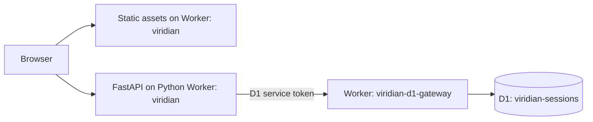

# Cloudflare deployment

Production is one Cloudflare Workers deployment with the frontend and
FastAPI backend, a separate authenticated D1 gateway, and one D1 database:



The production profile targets Cloudflare's Free plan and uses no paid
Cloudflare features or third-party provider credentials. It sets
`MOCK_MODE=true`, `LLM_PROVIDER=mock`, and `LANGSMITH_TRACING=false`. Chat
answers use the checked-in synthetic incident corpus. OpenAI, Pinecone, and
LangSmith are not called by the hosted demo.

## Resources

| Resource | Name | Role |
|---|---|---|
| Python Worker + assets | `viridian` | Serves the UI and API on one origin. |
| D1 gateway | `viridian-d1-gateway` | Owner-authenticated data access. |
| D1 database | `viridian-sessions` | Session and message storage. |

The checked-in Wrangler files are templates. The D1 config contains a
non-deployable placeholder ID; CI renders a private config with the exact
database ID. The Python API config is rendered with the Cloudflare account,
release SHA, API origin, and D1 gateway origin. Both generated configs and
the one-shot secrets file are ignored by Git.

The new `viridian-sessions` database is initialized by the checked-in
forward-only migration. The migration validator rejects destructive SQL
before any remote apply. No data is copied from the deleted database.

## GitHub production environment

Create a GitHub Environment named `production`, restrict it to `main`, and
add these variables:

| Variable | Value |
|---|---|
| `CLOUDFLARE_ACCOUNT_ID` | Cloudflare account ID. |
| `CLOUDFLARE_D1_DATABASE_ID` | UUID for `viridian-sessions`. |
| `CLOUDFLARE_D1_GATEWAY_URL` | D1 gateway origin below. |
| `CLOUDFLARE_API_URL` | API origin below. |

- D1 gateway:
  `https://viridian-d1-gateway.thavarshan.workers.dev`
- API:
  `https://viridian.thavarshan.workers.dev`

Add these secrets:

| Secret | Purpose |
|---|---|
| `CLOUDFLARE_API_TOKEN` | Deploy Workers and apply D1 migrations. |
| `D1_SERVICE_TOKEN` | Shared only by the API and gateway Workers. |
| `AUTH_SIGNING_SECRET` | Signs short-lived demo bearer tokens. |
| `SMOKE_ANALYST_PASSWORD` | Synthetic Analyst demo account. |
| `SMOKE_VIEWER_PASSWORD` | Synthetic Viewer demo account. |
| `SMOKE_ADMIN_PASSWORD` | Synthetic Administrator demo account. |

The repository's public demo lists the three synthetic passwords in the
frontend. They must match the production environment secrets. Never reuse
these demo passwords. The signing key and D1 service token must each have at
least 32 characters. Secret values are not stored in Wrangler configuration
or printed by the deployment scripts.

## API Worker behavior

Cloudflare Python Workers run the existing FastAPI application through the
Workers ASGI adapter. The entrypoint copies Wrangler variables and secrets
into the environment before constructing the application. Since Python
Workers do not provide ordinary Python sockets, the D1 adapter uses a small
HTTPX transport backed by the Workers `fetch` API to reach the D1 gateway.
The hosted Worker uses role-filtered, extractive chat over the synthetic
fixtures because LangGraph requires `ormsgpack`, which currently has no
compatible Pyodide wheel. Local Python runs keep the full LangGraph workflow.

The API Worker configuration binds `apps/web/public` as static assets. The
Worker handles `/api/*`, `/health`, `/ready`, `/version`, and API docs before
the static asset fallback. Browser traffic uses the shared
`https://viridian.thavarshan.workers.dev` origin.

## Release flow

The single `.github/workflows/ci.yml` workflow deploys only after every
required check passes for the current `main` commit:

1. Confirm the approved commit is still the tip of `main`.
2. Validate the exact Cloudflare D1 name and UUID.
3. Apply approved forward-only migrations and deploy
   `viridian-d1-gateway`.
4. Smoke the gateway's health, authentication, and D1 read/write behavior.
5. Deploy the Python API and static assets as `viridian`.
6. Smoke static files, API health and readiness, mock configuration,
   Analyst and Viewer authentication, session ownership, SSE chat, and
   persisted D1 history.
7. Report success only when both deployments and both smoke checks pass.

Production deployment jobs use Cloudflare secrets and the synthetic smoke
accounts. They do not configure external model, vector, or tracing services.

## Local development

Use the standard local API and UI for normal development:

```bash
uv sync --all-groups --all-extras
make setup
make dev
```

For the disposable local Cloudflare D1 gateway simulation, use
`make cloud-sim`. It does not access the remote Cloudflare account or
production D1. The `apps/ui` Streamlit client remains available locally and
through the existing Streamlit Cloud deployment. That deployment stays
active by request outside this release workflow; Cloudflare is the canonical
demo.
