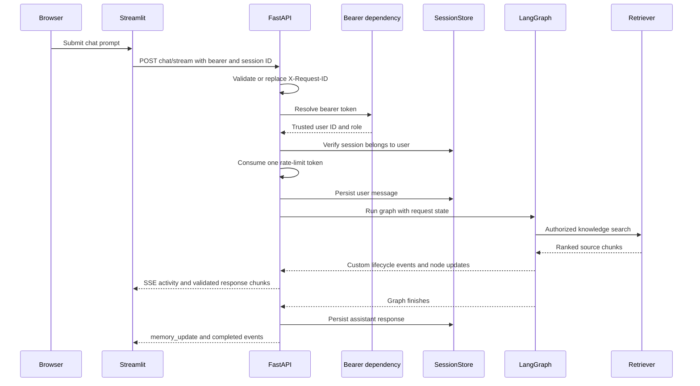

# Request lifecycle

## API surface

The API prefix defaults to `/api/v1`. Health routes are not versioned.

| Method and path | Authentication | Behavior |
|---|---|---|
| `GET /health` | None | Confirms the process can answer. |
| `GET /ready` | None | Checks the configured session store only. |
| `POST /api/v1/auth/token` | None | Validates local credentials and issues an opaque token. |
| `GET /api/v1/me` | Bearer | Returns the token's server-resolved user ID and role. |
| `POST /api/v1/chat/sessions` | Bearer | Creates an owner-scoped session. |
| `GET /api/v1/chat/sessions/{session_id}` | Bearer | Reads an owned session and its ordered messages. |
| `POST /api/v1/chat/stream` | Bearer | Stores a user turn and streams activity as SSE. |

Request schemas reject unexpected fields, cap user text lengths, and trim
chat-message whitespace. A blank message receives HTTP 422 before route
logic. The login request cannot set a role.

## Streaming turn

### 1. UI request

`AssistantApiClient.stream_chat` makes a synchronous httpx streaming POST.
It adds a bearer header only when a token exists, checks the HTTP status,
then parses each non-empty SSE `data:` line as JSON. The client does not
assemble multi-line SSE data fields. Streaming holds the Streamlit execution
thread until the response ends or fails.

Login, identity, and session requests use a 10-second httpx timeout;
streaming uses 60 seconds. These are UI HTTP client limits, not graph,
retrieval, SQLite, or provider execution deadlines.

The UI renders the user's prompt immediately. For each event, it displays
activity in the sidebar, appends `response_chunk` messages into the answer,
and shows failure messages. On the next rerun it loads history from the API.
The UI's `session_state` owns its token, identity, and selected session ID;
the server remains the source of roles, ownership, and persisted history.
Login and session-creation HTTP errors appear as error messages; history
load errors appear as warnings. Stream status errors display the API's safe
message, while connection errors show a reachability message.

### 2. Request correlation and authentication

`RequestIdMiddleware` accepts `X-Request-ID` only when it matches the
configured safe character set and 128-character limit. Otherwise it creates
a UUID. It stores the ID on request state, places it in a context variable
for logs, returns it in the response header, and resets the context in a
`finally` block.

The FastAPI bearer dependency resolves the token through the process-local
`AuthService`. Missing or unknown tokens receive HTTP 401 with a Bearer
challenge. The resulting user ID and role are trusted for the rest of the
request. Tokens do not expire and are not shared across API processes.

### 3. Ownership and rate limit

The chat route checks the session through an owner-scoped store query before
doing work. A missing session and a foreign-owned session both return 404.
It then consumes one token from the authenticated user's in-memory bucket.
An empty bucket returns HTTP 429 with a `Retry-After` value.

The input guardrail also runs before persistence. Clear instruction-override
or credential-exfiltration requests receive HTTP 400 and are not stored.
Only after these checks does the route append the user message. Therefore an
invalid owner, rejected prompt, or rate-limited request does not create a
message. If later graph execution fails, the user message remains in history.

### 4. Graph inputs and node updates

`ChatService` creates `AgentState` with request ID, session ID, server user
ID, server role, current question, recent owner-scoped prior history, and an
empty event list. The graph runs with `stream_mode=["updates", "custom"]`,
LangGraph v2 stream parts, and request/session metadata. Its `thread_id` is
not backed by a checkpointer.

Each graph node returns a partial state update. LangGraph merges ordinary
fields and applies `operator.add` to `events`. Custom events report agent
starts/completions and tool starts/completions as operations execute. The
service validates both custom and update event payloads with
`ActivityEvent`, tracks the final response and citation count, then yields
events to the route. Research tool metadata has counts and safe error codes;
it excludes its query and result content.

### 5. Retrieval, response, and validation

With `LLM_PROVIDER=openai`, the Supervisor requests a structured retrieval,
research, or analysis route. It cannot provide or modify authorization
fields. Mock mode
uses the existing case-insensitive keyword rule for `investigate`, `compare`,
and `analyze`. Direct retrieval performs one authorized search. Research
recursively expands model-proposed subtasks to depth two and runs at most
four searches under a twenty-document and thirty-second budget. It preserves
per-task source IDs and aggregates results using full document/chunk identity.
Partial failures leave successful branches available to Response. Explicit
arithmetic requests route to `PythonAnalysisTool`, which parses literal
numbers and is denied to viewers by ToolRegistry.

Direct retrieval and every research leaf use the server role with
`ToolRegistry`, then call `KnowledgeSearchTool`. The tool maps the role to
allowed access levels before retrieval. Mock mode searches local fixture
JSON. With mock mode off,
`HybridRetriever` concurrently requests Pinecone dense semantic and BM25
full-text rankings with provider-side access and department filters. The
adapter checks returned metadata again before exposing chunk content, and
RRF merges results by complete document/chunk identity.

With configured OpenAI, the Response node generates structured claims from
authorized evidence and supplies complete source identities. Mock mode
returns extractive claims from the first two results. The graph resolves
citations to retrieved chunks and withholds answers containing unknown
identities. With no results, it returns a fixed no-evidence message. Current
`response_chunk` events slice the completed answer; they are not streamed
model tokens.

### 6. Persistence and completion

After the graph completes, `ChatService` appends the assistant response.
It then emits `memory_update` and `completed`. The service catches graph
exceptions and reports a generic failure. A `LookupError` during assistant
persistence also becomes a generic memory failure; other storage exceptions
reach the route's stream boundary and become a generic stream failure.

If response validation fails, the graph substitutes a fixed withheld-answer
message. It does not emit response chunks for the invalid answer. The graph
still reaches its terminal node; clients should inspect the validation and
failure events rather than assume every completed stream contains a useful
answer.

## Error contract

| Failure | HTTP or stream behavior |
|---|---|
| Missing/unknown bearer | HTTP 401 before route work. |
| Invalid request body | HTTP 422 with error type and field location only. |
| Missing or foreign session | HTTP 404 with the same message. |
| Empty rate bucket | HTTP 429 with `Retry-After`. |
| Rejected override or credential-exfiltration prompt | HTTP 400 before persistence. |
| Graph or provider exception after SSE starts | Generic `failure` event; exception text stays server-side. |
| Assistant persistence `LookupError` | Generic memory `failure` event. |
| Other stream exception | Generic `failure` event from the route boundary. |

The route cannot change the HTTP status after the streaming response begins.
Failures during event generation are represented in the SSE body instead.
The application does not retry providers or promise partial retrieval
results.
